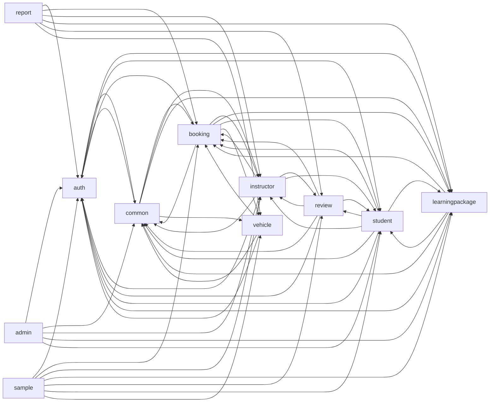
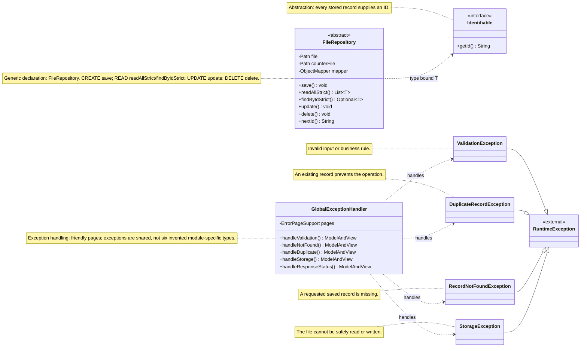
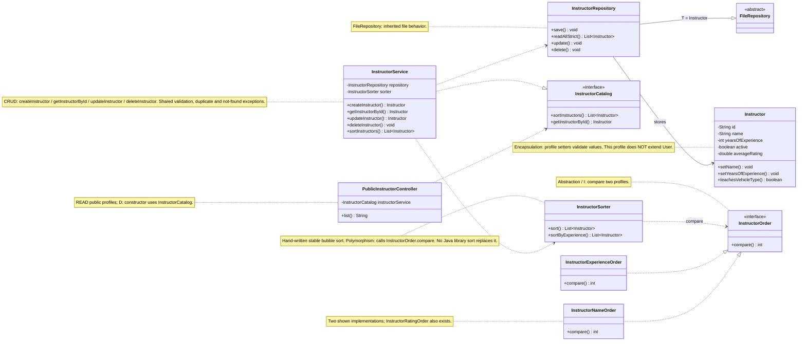
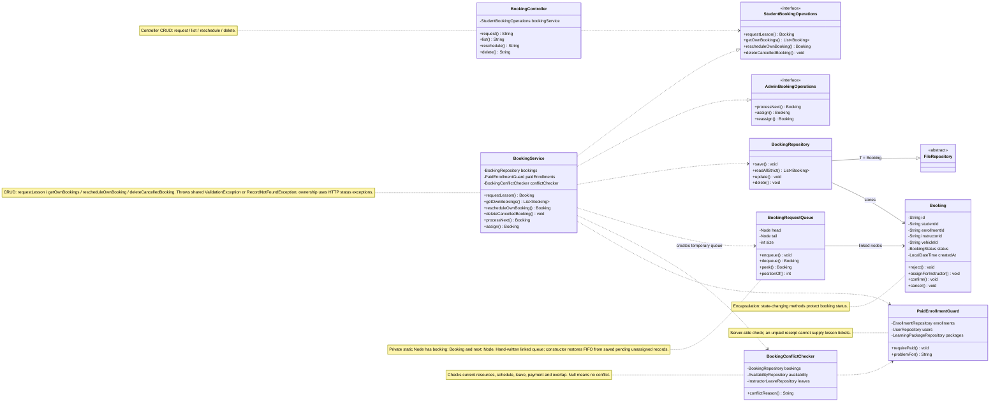
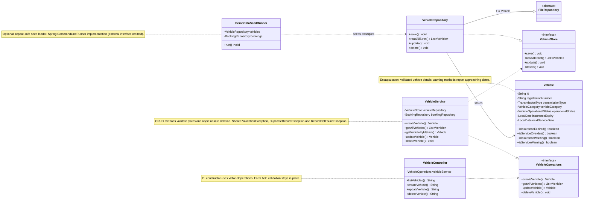
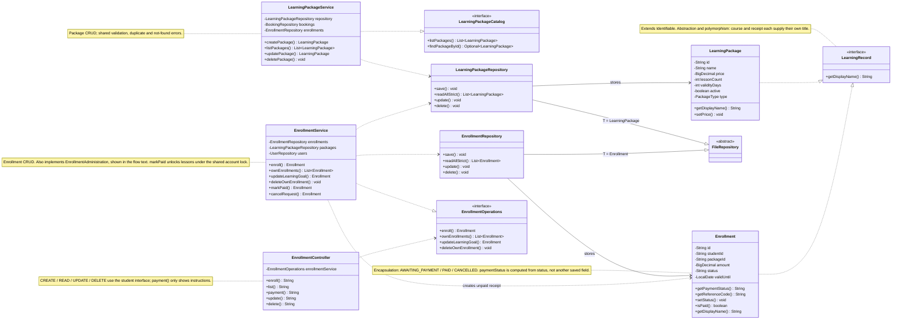
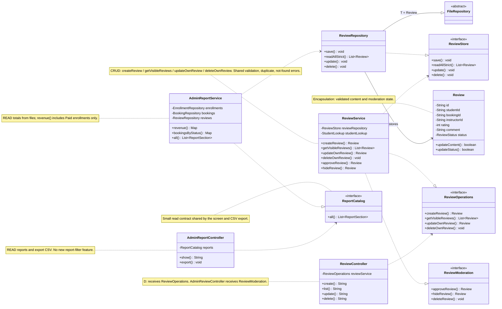
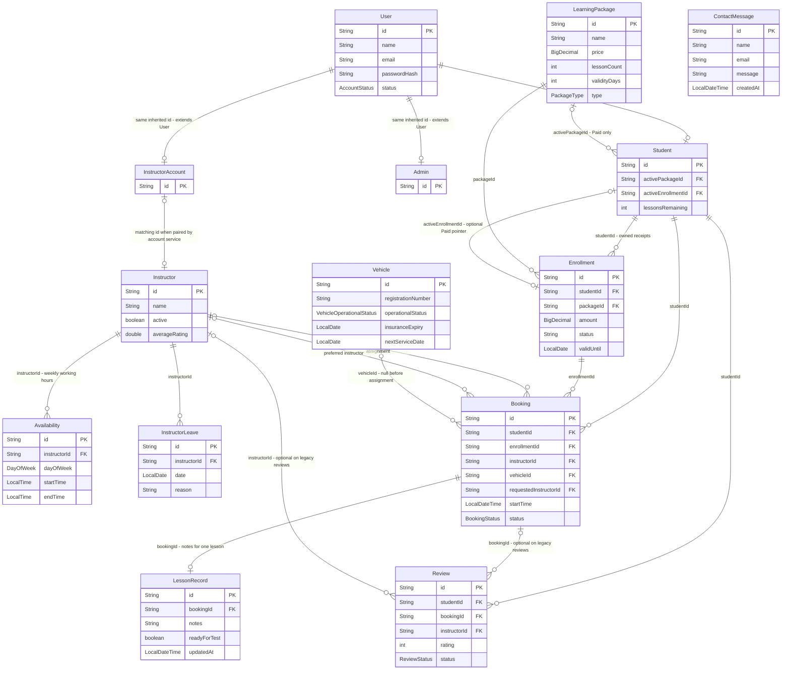

# Class diagrams and system flows

Owner: **IT26101135**, shared documentation. Phase B. Source checked: **9 November 2026**.

These diagrams describe the Java files currently in this checkout. They do not change the application. Phase A already has its own dated snapshot in [GIT_BRANCH_PLAN.md](GIT_BRANCH_PLAN.md); its old Git counts are not a new comparison made here. The more recent [MERGE_ANALYSIS.md](MERGE_ANALYSIS.md) describes an earlier failing build, not a test result obtained by this documentation task.

## Read the notation first

- A box is a real Java type. `-` means a private field; `+` means a public operation.
- `Child --|> Parent` means **extends**. `Implementation ..|> Interface` means **implements**.
- A dashed arrow marked uses means one class calls or receives another. A plain stores arrow means a repository handles that model; it does not mean the repository contains a single model field.
- Method **names and return types** come from source. **Parameter lists are intentionally hidden**: `method()` here is a short diagram label, not a claim that the Java method takes no arguments. Constructors, overloads and most getters/setters are hidden. Use the linked source for full signatures.
- `FileRepository` means `FileRepository<T extends Identifiable>`. Its subclasses choose their real record type. Mermaid uses `List~Type~` for generics; map type arguments are hidden in Mermaid to avoid its multi-argument generic limitation. PlantUML keeps the declared map types.
- Each member diagram has about ten key types. The packages/reviews diagrams have ten module types plus the shared repository parent. The shared figure explains the custom exceptions once.
- CRUD labels identify real operations. Abstraction, encapsulation, inheritance and polymorphism are Java concepts; exception handling is also highlighted because our project brief asks each student to explain it.
- These are teaching diagrams, not database schema changes, new interfaces or proposed refactors.

## 1. Package overview

Arrows show **direct cross-package imports in main Java source**, not a required startup order and not every runtime method call. All eleven requested packages are included. The current source has **55 distinct import pairs**. Cycles exist; we do not pretend the modules are independent.



[PlantUML copy](diagrams/plantuml/00-package-overview.puml)

**How to read this diagram:** Start at a controller's package and follow its arrows to the packages it imports. For example, booking reads student, package, instructor and vehicle information. Common also imports feature packages because it contains the home page and dashboard summaries, so it is not a completely independent base library.

**How to explain it in the viva:**

1. Our code is grouped by school task, such as bookings and vehicles.
2. A package arrow shows that its source uses a type from another package.
3. Booking needs several modules to check a real lesson.
4. The common package includes both shared helpers and cross-module page summaries.
5. Some arrows form cycles, which is why splitting this work into independent builds needs care.

| Package | Direct imported project packages |
| --- | --- |
| `admin` | `auth`, `common`, `instructor`, `learningpackage`, `student` |
| `auth` | `common`, `learningpackage`, `student` |
| `booking` | `auth`, `common`, `instructor`, `learningpackage`, `student`, `vehicle` |
| `common` | `auth`, `booking`, `instructor`, `learningpackage`, `vehicle` |
| `instructor` | `auth`, `booking`, `common`, `review`, `student` |
| `learningpackage` | `auth`, `booking`, `common`, `student` |
| `report` | `auth`, `booking`, `instructor`, `learningpackage`, `review`, `vehicle` |
| `review` | `auth`, `booking`, `common`, `instructor`, `student` |
| `sample` | `auth`, `booking`, `instructor`, `learningpackage`, `review`, `student`, `vehicle` |
| `student` | `auth`, `booking`, `common`, `instructor`, `learningpackage`, `review` |
| `vehicle` | `auth`, `booking`, `common` |

## 2. Shared foundation — IT26101135



[PlantUML copy](diagrams/plantuml/01-shared-foundation.puml)

**How to read this diagram:** The shared repository is a reusable file drawer. Module repositories extend it with their own record type. Identifiable is the small promise that each record has an ID. The exception handler converts the four shared application exceptions into friendly web responses.

**How to explain it in the viva:**

1. I reuse one file repository instead of writing the same file code six times.
2. Each stored model promises an ID through Identifiable.
3. Our module repositories inherit the shared storage operations.
4. We throw named exceptions when input, records or files are wrong.
5. The global handler turns these failures into a readable page.

**Source files for these boxes:**

| Type | Actual source |
| --- | --- |
| `Identifiable` | [common/model/Identifiable.java](../src/main/java/com/drivingschool/common/model/Identifiable.java) |
| `FileRepository` | [common/repository/FileRepository.java](../src/main/java/com/drivingschool/common/repository/FileRepository.java) |
| `RuntimeException` | Java standard library; no project source file. |
| `ValidationException` | [common/exception/ValidationException.java](../src/main/java/com/drivingschool/common/exception/ValidationException.java) |
| `DuplicateRecordException` | [common/exception/DuplicateRecordException.java](../src/main/java/com/drivingschool/common/exception/DuplicateRecordException.java) |
| `RecordNotFoundException` | [common/exception/RecordNotFoundException.java](../src/main/java/com/drivingschool/common/exception/RecordNotFoundException.java) |
| `StorageException` | [common/exception/StorageException.java](../src/main/java/com/drivingschool/common/exception/StorageException.java) |
| `GlobalExceptionHandler` | [common/exception/GlobalExceptionHandler.java](../src/main/java/com/drivingschool/common/exception/GlobalExceptionHandler.java) |

## 3. IT26101135 — authentication and students

```mermaid
classDiagram
direction LR
class User {
  <<abstract>>
  -String id
  -String name
  -String email
  -String passwordHash
  -AccountStatus status
  +getRole() Role
  +getDashboardPath() String
  +setEmail() void
}
note for User "Encapsulation: private account fields and validating setters. Abstract role/dashboard methods are overridden."
class Student {
  -String phone
  -String activePackageId
  -String activeEnrollmentId
  -int lessonsRemaining
  +getRole() Role
  +getDashboardPath() String
}
note for Student "Inheritance: Student extends User. Polymorphism: its own role and dashboard."
class AuthController {
  -AuthService authService
  -AuthSessionService authSessionService
  +register() String
  +login() String
  +logout() String
}
note for AuthController "CREATE register; READ/login uses account credentials. Password is not returned to the page."
class AuthService {
  -UserRepository userRepository
  -PasswordHasher passwordHasher
  +registerStudent() Student
  +authenticate() Optional~User~
}
note for AuthService "CREATE registerStudent: new students are ACTIVE. READ authenticate: compares a hash."
class AuthSessionService {
  -AuthService authService
  -UserRepository userRepository
  +loginWithResult() LoginResult
  +getCurrentUser() Optional~User~
  +requireLogin() User
  +requireAdmin() User
  +logout() void
}
class UserRepository {
  -EnrollmentRepository enrollments
  +save() void
  +readAllStrict() List~User~
  +findByIdStrict() Optional~User~
  +update() void
  +delete() void
}
note for UserRepository "Extends FileRepository<User> (shared figure). Storage CRUD; unpaid lesson balances are cleared on reads."
class StudentProfiles {
  <<interface>>
  +getOwnProfile() StudentProfile
  +updateOwnProfile() StudentProfile
}
note for StudentProfiles "Abstraction / I: a small profile contract."
class StudentProfileService {
  -UserRepository userRepository
  -AuthSessionService authSessionService
  +getOwnProfile() StudentProfile
  +updateOwnProfile() StudentProfile
}
note for StudentProfileService "READ/UPDATE own profile only. Duplicate/storage errors and HTTP ownership errors are shared; model setters validate details."
class StudentProfileController {
  -StudentProfiles profileService
  +showProfile() String
  +showEdit() String
  +updateProfile() String
}
note for StudentProfileController "D: constructor receives StudentProfiles, not its concrete implementation."
class StudentAccountService {
  -AuthSessionService auth
  -UserRepository users
  +deleteOwnAccount() void
}
note for StudentAccountService "DELETE account after linked-record checks. Controller is in the omission index."
Student --|> User
AuthController ..> AuthService
AuthController ..> AuthSessionService
AuthSessionService ..> AuthService
AuthService ..> UserRepository
AuthSessionService ..> UserRepository
UserRepository --> User : stores
AuthService ..> Student : creates
StudentProfileService ..|> StudentProfiles
StudentProfileController ..> StudentProfiles
StudentProfileService ..> UserRepository
StudentProfileService ..> AuthSessionService
StudentAccountService ..> UserRepository
```



[PlantUML copy](diagrams/plantuml/02-IT26101135.puml)

**How to read this diagram:** Start with the web controllers, then follow the arrows to the services and file repository. User is the shared parent and Student is one child. The profile page uses an interface, so it does not need file-storage details. The deletion service is shown separately because account removal has different checks.

**How to explain it in the viva:**

1. I register students as Active so they can log in immediately.
2. I store password hashes and reload the account when checking a session.
3. Student inherits the shared account details from User.
4. My profile controller receives the small StudentProfiles interface.
5. I validate edits and check linked records before deleting an account.

**Source files for these boxes:**

| Type | Actual source |
| --- | --- |
| `User` | [auth/model/User.java](../src/main/java/com/drivingschool/auth/model/User.java) |
| `Student` | [student/model/Student.java](../src/main/java/com/drivingschool/student/model/Student.java) |
| `AuthController` | [auth/controller/AuthController.java](../src/main/java/com/drivingschool/auth/controller/AuthController.java) |
| `AuthService` | [auth/service/AuthService.java](../src/main/java/com/drivingschool/auth/service/AuthService.java) |
| `AuthSessionService` | [auth/service/AuthSessionService.java](../src/main/java/com/drivingschool/auth/service/AuthSessionService.java) |
| `UserRepository` | [auth/repository/UserRepository.java](../src/main/java/com/drivingschool/auth/repository/UserRepository.java) |
| `StudentProfiles` | [student/api/StudentProfiles.java](../src/main/java/com/drivingschool/student/api/StudentProfiles.java) |
| `StudentProfileService` | [student/service/StudentProfileService.java](../src/main/java/com/drivingschool/student/service/StudentProfileService.java) |
| `StudentProfileController` | [student/controller/StudentProfileController.java](../src/main/java/com/drivingschool/student/controller/StudentProfileController.java) |
| `StudentAccountService` | [student/service/StudentAccountService.java](../src/main/java/com/drivingschool/student/service/StudentAccountService.java) |

## 4. IT26101133 — instructor profiles and bubble sort



[PlantUML copy](diagrams/plantuml/03-IT26101133.puml)

**How to read this diagram:** The public controller uses InstructorCatalog. InstructorService handles profile CRUD and asks InstructorSorter to order a copy of the list. The sorter uses the same comparison method on different ordering classes. Availability and leave are shown in the entity diagram and FIFO sequence so this class view stays small.

**How to explain it in the viva:**

1. I keep the instructor profile separate from the login account.
2. My repository inherits safe file operations.
3. My service creates, finds, edits and deletes profiles.
4. My bubble sort compares neighboring profiles and swaps them when needed.
5. The same compare method orders names or experience through different classes.

**Source files for these boxes:**

| Type | Actual source |
| --- | --- |
| `Instructor` | [instructor/model/Instructor.java](../src/main/java/com/drivingschool/instructor/model/Instructor.java) |
| `InstructorRepository` | [instructor/repository/InstructorRepository.java](../src/main/java/com/drivingschool/instructor/repository/InstructorRepository.java) |
| `FileRepository` | [common/repository/FileRepository.java](../src/main/java/com/drivingschool/common/repository/FileRepository.java) |
| `InstructorCatalog` | [instructor/service/InstructorCatalog.java](../src/main/java/com/drivingschool/instructor/service/InstructorCatalog.java) |
| `InstructorService` | [instructor/service/InstructorService.java](../src/main/java/com/drivingschool/instructor/service/InstructorService.java) |
| `PublicInstructorController` | [instructor/controller/PublicInstructorController.java](../src/main/java/com/drivingschool/instructor/controller/PublicInstructorController.java) |
| `InstructorSorter` | [instructor/service/InstructorSorter.java](../src/main/java/com/drivingschool/instructor/service/InstructorSorter.java) |
| `InstructorOrder` | [instructor/service/InstructorOrder.java](../src/main/java/com/drivingschool/instructor/service/InstructorOrder.java) |
| `InstructorExperienceOrder` | [instructor/service/InstructorExperienceOrder.java](../src/main/java/com/drivingschool/instructor/service/InstructorExperienceOrder.java) |
| `InstructorNameOrder` | [instructor/service/InstructorNameOrder.java](../src/main/java/com/drivingschool/instructor/service/InstructorNameOrder.java) |

## 5. IT26101134 — bookings, FIFO and scheduling



[PlantUML copy](diagrams/plantuml/04-IT26101134.puml)

**How to read this diagram:** The student page uses StudentBookingOperations and the admin uses a separate interface. One BookingService implements both. It rebuilds the queue from saved requests, checks payment and conflicts, then updates a booking. A dequeued object is not a deleted file record.

**How to explain it in the viva:**

1. I save each request before it enters the waiting line.
2. My linked queue handles the oldest unassigned request first.
3. I check Paid enrollment on the server, not only on the page.
4. I check the instructor, vehicle, working hours, leave and overlaps before assignment.
5. I save the result, so restarting can rebuild the queue from the file.

**Source files for these boxes:**

| Type | Actual source |
| --- | --- |
| `Booking` | [booking/model/Booking.java](../src/main/java/com/drivingschool/booking/model/Booking.java) |
| `BookingRepository` | [booking/repository/BookingRepository.java](../src/main/java/com/drivingschool/booking/repository/BookingRepository.java) |
| `FileRepository` | [common/repository/FileRepository.java](../src/main/java/com/drivingschool/common/repository/FileRepository.java) |
| `StudentBookingOperations` | [booking/service/StudentBookingOperations.java](../src/main/java/com/drivingschool/booking/service/StudentBookingOperations.java) |
| `AdminBookingOperations` | [booking/service/AdminBookingOperations.java](../src/main/java/com/drivingschool/booking/service/AdminBookingOperations.java) |
| `BookingController` | [booking/controller/BookingController.java](../src/main/java/com/drivingschool/booking/controller/BookingController.java) |
| `BookingService` | [booking/service/BookingService.java](../src/main/java/com/drivingschool/booking/service/BookingService.java) |
| `BookingRequestQueue` | [booking/util/BookingRequestQueue.java](../src/main/java/com/drivingschool/booking/util/BookingRequestQueue.java) |
| `BookingConflictChecker` | [booking/service/BookingConflictChecker.java](../src/main/java/com/drivingschool/booking/service/BookingConflictChecker.java) |
| `PaidEnrollmentGuard` | [booking/service/PaidEnrollmentGuard.java](../src/main/java/com/drivingschool/booking/service/PaidEnrollmentGuard.java) |

## 6. IT26101132 — vehicles and sample data



[PlantUML copy](diagrams/plantuml/05-IT26101132.puml)

**How to read this diagram:** The web controller uses a small vehicle interface. VehicleService applies the fleet rules, while VehicleStore describes saving and loading. VehicleRepository both implements that contract and inherits the shared file repository. The sample loader uses the same real repositories to create examples when explicitly enabled.

**How to explain it in the viva:**

1. I keep each teaching vehicle's details in a validated model.
2. My service checks registration numbers before saving.
3. The repository handles the vehicle file.
4. The model reports overdue and approaching insurance or service dates.
5. My optional seed loader can run twice without duplicating its examples.

**Source files for these boxes:**

| Type | Actual source |
| --- | --- |
| `Vehicle` | [vehicle/model/Vehicle.java](../src/main/java/com/drivingschool/vehicle/model/Vehicle.java) |
| `VehicleStore` | [vehicle/api/VehicleStore.java](../src/main/java/com/drivingschool/vehicle/api/VehicleStore.java) |
| `VehicleRepository` | [vehicle/repository/VehicleRepository.java](../src/main/java/com/drivingschool/vehicle/repository/VehicleRepository.java) |
| `FileRepository` | [common/repository/FileRepository.java](../src/main/java/com/drivingschool/common/repository/FileRepository.java) |
| `VehicleOperations` | [vehicle/api/VehicleOperations.java](../src/main/java/com/drivingschool/vehicle/api/VehicleOperations.java) |
| `VehicleService` | [vehicle/service/VehicleService.java](../src/main/java/com/drivingschool/vehicle/service/VehicleService.java) |
| `VehicleController` | [vehicle/controller/VehicleController.java](../src/main/java/com/drivingschool/vehicle/controller/VehicleController.java) |
| `DemoDataSeedRunner` | [sample/DemoDataSeedRunner.java](../src/main/java/com/drivingschool/sample/DemoDataSeedRunner.java) |

## 7. IT26101136 — packages and payment confirmation



[PlantUML copy](diagrams/plantuml/06-IT26101136.puml)

**How to read this diagram:** A package is the offered course; an enrollment is a student's receipt for one course. Both implement LearningRecord, but their titles differ. The student controller receives EnrollmentOperations. Admin payment actions use EnrollmentAdministration on the same EnrollmentService; that admin interface is named here rather than adding more boxes.

**How to explain it in the viva:**

1. I separate the offered package from a student's enrollment receipt.
2. Enrollment starts Awaiting payment and does not unlock lessons.
3. The admin confirms payment after checking the student and package.
4. Confirmation starts validity and gives the student their lesson balance.
5. Both course and receipt share a small interface but display different titles.

**Source files for these boxes:**

| Type | Actual source |
| --- | --- |
| `LearningRecord` | [learningpackage/model/LearningRecord.java](../src/main/java/com/drivingschool/learningpackage/model/LearningRecord.java) |
| `LearningPackage` | [learningpackage/model/LearningPackage.java](../src/main/java/com/drivingschool/learningpackage/model/LearningPackage.java) |
| `Enrollment` | [learningpackage/model/Enrollment.java](../src/main/java/com/drivingschool/learningpackage/model/Enrollment.java) |
| `LearningPackageCatalog` | [learningpackage/service/LearningPackageCatalog.java](../src/main/java/com/drivingschool/learningpackage/service/LearningPackageCatalog.java) |
| `LearningPackageService` | [learningpackage/service/LearningPackageService.java](../src/main/java/com/drivingschool/learningpackage/service/LearningPackageService.java) |
| `LearningPackageRepository` | [learningpackage/repository/LearningPackageRepository.java](../src/main/java/com/drivingschool/learningpackage/repository/LearningPackageRepository.java) |
| `EnrollmentRepository` | [learningpackage/repository/EnrollmentRepository.java](../src/main/java/com/drivingschool/learningpackage/repository/EnrollmentRepository.java) |
| `EnrollmentOperations` | [learningpackage/service/EnrollmentOperations.java](../src/main/java/com/drivingschool/learningpackage/service/EnrollmentOperations.java) |
| `EnrollmentService` | [learningpackage/service/EnrollmentService.java](../src/main/java/com/drivingschool/learningpackage/service/EnrollmentService.java) |
| `EnrollmentController` | [learningpackage/controller/EnrollmentController.java](../src/main/java/com/drivingschool/learningpackage/controller/EnrollmentController.java) |
| `FileRepository` | [common/repository/FileRepository.java](../src/main/java/com/drivingschool/common/repository/FileRepository.java) |

## 8. IT26101137 — reviews, moderation and reports



[PlantUML copy](diagrams/plantuml/07-IT26101137.puml)

**How to read this diagram:** ReviewService supplies two small interfaces: student/public feedback and admin moderation. It depends on ReviewStore rather than a particular file writer. Reports are a separate read service, with one catalog supplying both the web page and CSV. Repository inheritance is the visible class-inheritance example; models do not need invented parent classes.

**How to explain it in the viva:**

1. I check who owns a review before changing or deleting it.
2. My moderation interface separates admin decisions from student editing.
3. Only approved feedback contributes to the displayed instructor rating.
4. My report service reads saved records and counts Paid revenue only.
5. The report screen and CSV use the same catalog of totals.

**Source files for these boxes:**

| Type | Actual source |
| --- | --- |
| `Review` | [review/model/Review.java](../src/main/java/com/drivingschool/review/model/Review.java) |
| `ReviewStore` | [review/api/ReviewStore.java](../src/main/java/com/drivingschool/review/api/ReviewStore.java) |
| `ReviewRepository` | [review/repository/ReviewRepository.java](../src/main/java/com/drivingschool/review/repository/ReviewRepository.java) |
| `ReviewOperations` | [review/service/ReviewOperations.java](../src/main/java/com/drivingschool/review/service/ReviewOperations.java) |
| `ReviewModeration` | [review/service/ReviewModeration.java](../src/main/java/com/drivingschool/review/service/ReviewModeration.java) |
| `ReviewService` | [review/service/ReviewService.java](../src/main/java/com/drivingschool/review/service/ReviewService.java) |
| `ReviewController` | [review/controller/ReviewController.java](../src/main/java/com/drivingschool/review/controller/ReviewController.java) |
| `ReportCatalog` | [report/service/ReportCatalog.java](../src/main/java/com/drivingschool/report/service/ReportCatalog.java) |
| `AdminReportService` | [report/service/AdminReportService.java](../src/main/java/com/drivingschool/report/service/AdminReportService.java) |
| `AdminReportController` | [report/controller/AdminReportController.java](../src/main/java/com/drivingschool/report/controller/AdminReportController.java) |
| `FileRepository` | [common/repository/FileRepository.java](../src/main/java/com/drivingschool/common/repository/FileRepository.java) |

## 9. Important supporting flows outside the small class boxes

These types are real and remain in the project. They are described here so the instructor diagram can focus on bubble sort without hiding the working schedule.

| Area | Actual types and operations | What to say |
| --- | --- | --- |
| Instructor login account | `InstructorAccount extends User`; `InstructorAccountService.create/update/delete` | The login account is separate from `Instructor`, the teaching profile. The account service pairs them using the same ID. Profile-only service/unit-test records can exist without a login account. |
| Weekly schedule | `InstructorAvailabilityController` uses `InstructorScheduleOperations`; `InstructorScheduleService` implements it | The routed page uses `availability`, `leaves`, `addAvailability`, `updateAvailability`, `deleteAvailability`, `addLeave`, `updateLeave`, `deleteLeave`. These use `AvailabilityRepository` and `InstructorLeaveRepository`. |
| Lesson notes/progress | `InstructorLessonService.saveNotes/ownRecords/studentProgress`; `LessonRecordRepository` | Notes attach to a booking ID. Student progress reads completed lesson records; there is no separate stored Progress entity. |
| Current incoming bean wiring | `InstructorConfig.instructorAvailabilityRepository/instructorLookup/instructorAvailabilityService` | These additive bean methods now exist in the current source. This differs from the earlier snapshot described in MERGE_ANALYSIS.md. Runtime correctness is not proven by this documentation inspection. |
| Admin payment page | `AdminEnrollmentController` uses `EnrollmentAdministration`; implemented by `EnrollmentService` | `list` reads `awaitingPayments`; `markPaid` calls `markPaid`; `cancel` calls `cancelRequest`. |
| Admin profile/package forms | `AdminManagementController` delegates to instructor, student and package services | This shared controller contains CRUD endpoints for more than one member's module. A single diagram does not imply each feature has a separate admin controller. |
| Mega-menu | `PackageNavigationAdvice.choices`, `PackageNavigationCard.consider`, `LearningPackageCatalog.listPackages` | The navigation groups active package data and chooses the lowest price. It does not invent a second Package entity. |

**Limits worth saying honestly:** only `Student`, `Admin` and `InstructorAccount` inherit from `User`; the teaching `Instructor` profile does not. `LearningRecord` is an interface, not an abstract parent class. Review and vehicle models implement `Identifiable`; their concrete repositories show class inheritance. One interface with one implementation demonstrates interface-based calling, but we must not invent a second implementation to claim different behavior. The instructor order classes and User subclasses give clear examples with different behavior.

## 10. CRUD reading guide

This is a small cross-check for the diagrams, not a replacement for the detailed [CRUD_MAP.md](CRUD_MAP.md). Method names are real; overload arguments are in source.

| Member | Entity | CREATE | READ | UPDATE | DELETE | Controller entry points |
| --- | --- | --- | --- | --- | --- | --- |
| IT26101135 | Student account/profile | `AuthService.registerStudent` | `StudentProfileService.getOwnProfile` | `StudentProfileService.updateOwnProfile` | `StudentAccountService.deleteOwnAccount` | `AuthController.register`; `StudentProfileController.showProfile/updateProfile`; `StudentAccountController.delete`. |
| IT26101133 | Instructor profile | `InstructorService.createInstructor` | `InstructorService.getInstructorById` | `InstructorService.updateInstructor` | `InstructorService.deleteInstructor` | Public: `PublicInstructorController.list`. Admin: `AdminManagementController.createInstructor/updateInstructorProfile/deleteInstructor`, through the account coordinator where appropriate. |
| IT26101134 | Booking | `BookingService.requestLesson` | `BookingService.getOwnBookings` | `BookingService.rescheduleOwnBooking` | `BookingService.deleteCancelledBooking` | `BookingController.request/list/reschedule/delete`. Cancellation changes status; it is not the physical delete operation. |
| IT26101132 | Vehicle | `VehicleService.createVehicle` | `VehicleService.getAllVehicles` | `VehicleService.updateVehicle` | `VehicleService.deleteVehicle` | `VehicleController.createVehicle/listVehicles/updateVehicle/deleteVehicle`. |
| IT26101136 | Package | `LearningPackageService.createPackage` | `LearningPackageService.listPackages` | `LearningPackageService.updatePackage` | `LearningPackageService.deletePackage` | `LearningPackageController.listActivePackages/details`; `AdminManagementController.createPackage/updatePackage/deletePackage`. |
| IT26101136 | Enrollment | `EnrollmentService.enroll` | `EnrollmentService.ownEnrollments` | `EnrollmentService.updateLearningGoal` | `EnrollmentService.deleteOwnEnrollment` | `EnrollmentController.enroll/list/update/delete`. Payment confirmation is another UPDATE, not CREATE. |
| IT26101137 | Review | `ReviewService.createReview` | `ReviewService.getVisibleReviews` | `ReviewService.updateOwnReview` | `ReviewService.deleteOwnReview` | `ReviewController.create/list/update/delete`; moderation has separate admin entry points. |

All concrete module repositories inherit or override `save`, `readAllStrict/findByIdStrict`, `update` and `delete` from `FileRepository`. The generic parent checks record IDs and handles the file; a service adds the school rules.

**Exception handling:** shared `ValidationException` becomes HTTP 400, `RecordNotFoundException` becomes 404, `DuplicateRecordException` becomes 409 and `StorageException` becomes 500 through `GlobalExceptionHandler`. Some controllers catch a business exception and redirect with a flash message instead. Access/session code also uses Spring's `ResponseStatusException`; do not describe that as a custom class we wrote.

## 11. Sequence A — a student registers, pays manually and requests a lesson

This shows the successful route. Validation errors stop a step and produce the existing error page or controller flash message. CSRF filtering, access interception, model lookups and repeated file reads are not expanded into separate lifelines; they still run.

```mermaid
sequenceDiagram
autonumber
actor Student as Student browser
actor Admin as Admin browser
participant AC as AuthController
participant AS as AuthService
participant UR as UserRepository
participant SS as AuthSessionService
participant EC as EnrollmentController
participant ES as EnrollmentService
participant ER as EnrollmentRepository
participant AEC as AdminEnrollmentController
participant BC as BookingController
participant BS as BookingService
participant PG as PaidEnrollmentGuard
participant BR as BookingRepository
Student->>AC: POST /register: register(...)
AC->>AS: registerStudent(...)
Note over AS,UR: Under AccountWriteCoordinator.execute: validate email, hash password, create ACTIVE Student.
AS->>UR: save(student)
AC-->>Student: Redirect to /login?registered
Student->>AC: POST /login: login(...)
AC->>SS: loginWithResult(...)
SS->>AS: authenticate(...)
AS->>UR: readAllStrict()
Note over SS: Checks real status; invalidates the old session and stores the user ID in a new session.
AC-->>Student: Role-based redirect on success
Student->>EC: POST /enrollments: enroll(...)
EC->>ES: enroll(request, packageId)
Note over ES: Shared account lock: require student, reject duplicate waiting/active enrollment, check active package.
ES->>ER: save(AWAITING_PAYMENT enrollment)
EC-->>Student: Redirect /enrollments/{id}/payment
Student->>EC: GET /enrollments/{id}/payment: payment(...)
EC->>ES: ownEnrollment(request, id)
EC-->>Student: Payment instructions, captured amount, computed reference
Note over Student,Admin: Payment and receipt checking happen outside the app. No email is sent and no receipt is uploaded.
Admin->>AEC: POST /admin/enrollments/mark-paid: markPaid(...)
AEC->>ES: markPaid(request, enrollmentId)
Note over ES,UR: Admin + shared lock: reload waiting record; reject inactive package or non-ACTIVE student; set PAID and validity.
ES->>UR: update(student with active IDs and lessons)
ES->>ER: update(paid enrollment)
AEC-->>Admin: Success redirect /admin/enrollments
Student->>BC: POST /bookings: request(...)
BC->>BS: requestLesson(request, packageId, instructorId, startTime)
BS->>PG: requirePaid(studentId, activeEnrollmentId)
Note over BS: Check saved slot and active package; lock, recheck payment and conflictReason before saving.
BS->>BR: save(PENDING booking)
BC-->>Student: Redirect /bookings: request is waiting
Note over BC,BR: Admin assignment and instructor acceptance are later steps; requesting does not mean Confirmed.
```

[PlantUML copy](diagrams/plantuml/08-registration-payment-booking.puml)

**How to read this diagram:** Time moves from top to bottom. Each arrow names a real controller or service operation, or an HTTP request. Payment itself is outside the app. The successful confirmation updates the student and enrollment files under an application lock; this is not a database transaction.

**How to explain it in the viva:**

1. A new student is Active and can log in immediately.
2. Enrolling saves an Awaiting payment receipt with the package's captured price.
3. The student reads the instructions and pays outside our system.
4. The admin confirms payment once, which starts validity and unlocks lessons.
5. The student can then request a lesson, which is still Pending until later processing.

Important source details: `Enrollment.getReferenceCode()` computes the reference from the ID; it is not a separate persisted field. `getPaymentStatus()` maps the status for compatibility. `EnrollmentService.markPaid` sets `validUntil` from the confirmation date and current package validity; the working model has no stored `validFrom` field.

## 12. Sequence B — a pending request goes through FIFO and conflict checking

```mermaid
sequenceDiagram
autonumber
actor Admin as Admin browser
participant C as AdminBookingController
participant S as BookingService
participant A as AuthSessionService
participant R as BookingRepository
participant Q as BookingRequestQueue
participant G as PaidEnrollmentGuard
participant K as BookingConflictChecker
participant B as Booking
Admin->>C: POST /admin/bookings/process-next: processNext(...)
C->>S: processNext(request, instructorId, vehicleId)
S->>A: requireAdmin(request)
Note over S,R: BOOKING_LOCK uses AccountWriteCoordinator.class; it coordinates with payment/account writes in this JVM.
S->>R: readAllStrict()
S->>Q: new BookingRequestQueue(saved bookings)
Note over Q: Filter PENDING with no instructor; stable insertion sort by createdAt; enqueue linked nodes.
S->>Q: dequeue()
Q-->>S: oldest booking, or null
alt queue empty
S-->>C: Throw ValidationException: no pending requests
else head found
S->>S: assign(request, head.id, instructorId, vehicleId)
S->>A: requireAdmin(request)
S->>R: findByIdStrict(bookingId)
S->>R: readAllStrict()
S->>Q: new BookingRequestQueue(saved bookings)
S->>Q: peek()
Note over S,Q: assign rebuilds another queue and verifies the target is still its head; an out-of-order ID throws ValidationException.
S->>G: problemFor(studentId, enrollmentId)
alt unpaid, cancelled, expired or unusable enrollment
S->>B: reject(paymentProblem)
S->>R: update(rejected booking)
else payment permits booking
Note over S,K: Load InstructorRepository and VehicleRepository; missing/inactive/out-of-service resources raise an exception before the conflict call.
S->>K: conflictReason(target, instructorId, vehicleId)
Note over K: Checks current payment, availability, leave, overlap, qualifications and vehicle/course compatibility.
alt conflict reason returned
S->>B: reject(conflict)
S->>R: update(rejected booking)
else no conflict
S->>B: assignForInstructor(instructorId, vehicleId)
S->>R: update(assigned PENDING booking)
end
end
S-->>C: Assigned or rejected booking
C-->>Admin: Flash result and redirect /admin/bookings
end
Note over S,R: dequeue changes only an in-memory queue. Saving the changed booking makes the result survive restart; unexpected storage failures are not swallowed.
```

[PlantUML copy](diagrams/plantuml/09-fifo-conflict-check.puml)

**How to read this diagram:** `processNext` reads the oldest request, then `assign` rebuilds the queue and verifies its head again under the same lock. A business rejection is saved as a booking result. Removing a node from a temporary queue does not remove a line from the booking file.

**How to explain it in the viva:**

1. I rebuild the linked queue from Pending requests that have no assigned instructor.
2. I restore submission order by createdAt, keeping equal times in file order.
3. I take the first request and recheck payment, resources and timetable conflicts.
4. I save a rejection reason when payment or the conflict checker refuses it.
5. A successful assignment stays Pending until the assigned instructor accepts it.

`BookingService.acceptAssignedLesson` later calls `Booking.confirm`, changing status to Confirmed. Missing or inactive resources can throw before the conflict check; not every invalid input becomes a saved rejection. The diagram deliberately distinguishes those paths instead of promising that every error is silently consumed.

## 13. Entity relationships by ID

These are **logical record shapes in files**, not SQL tables. `PK` means the record's ID and `FK` means a string that links to another record; there is no database enforcing a foreign key. Services guard the links and some deletions. Old or manually damaged files can still contain broken links.

`LearningPackage` is the real class name; there is no entity class named `Package`. The `User`/child lines mean Java inheritance and the same account identity, not four independently stored tables. Users are stored polymorphically in the account file.



[PlantUML copy](diagrams/plantuml/10-entity-relationships.puml)

**How to read this diagram:** A circle means zero is allowed, a bar means one and a crow's foot means many. For example, one student's ID can appear in many enrollments. Optional assigned instructor/vehicle IDs are empty before assignment. The separate activeEnrollmentId arrow is the student's optional Paid receipt pointer, not their complete enrollment history.

**How to explain it in the viva:**

1. We connect records with saved string IDs instead of database foreign keys.
2. A student can have several receipts, but only the selected Paid receipt supplies active lesson tickets.
3. Each booking records its student and enrollment and later its assigned resources.
4. A lesson record stores feedback against one booking, and reviews also link to their student and optional legacy lesson/instructor IDs.
5. Contact messages stand alone, and the two instructor availability files remain separate.

The review-to-booking edge allows a collection for compatibility; do not infer that repeated reviews for the same completed lesson are permitted by the current create service. Lesson notes are intended to be one record per booking through `InstructorLessonService.saveNotes`; file storage itself does not supply a unique constraint.

Entity source files:

| Entity | Source |
| --- | --- |
| `User` | [auth/model/User.java](../src/main/java/com/drivingschool/auth/model/User.java) |
| `Student` | [student/model/Student.java](../src/main/java/com/drivingschool/student/model/Student.java) |
| `Admin` | [auth/model/Admin.java](../src/main/java/com/drivingschool/auth/model/Admin.java) |
| `InstructorAccount` | [auth/model/InstructorAccount.java](../src/main/java/com/drivingschool/auth/model/InstructorAccount.java) |
| `Instructor` | [instructor/model/Instructor.java](../src/main/java/com/drivingschool/instructor/model/Instructor.java) |
| `Availability` | [instructor/model/Availability.java](../src/main/java/com/drivingschool/instructor/model/Availability.java) |
| `InstructorLeave` | [instructor/model/InstructorLeave.java](../src/main/java/com/drivingschool/instructor/model/InstructorLeave.java) |
| `LessonRecord` | [instructor/model/LessonRecord.java](../src/main/java/com/drivingschool/instructor/model/LessonRecord.java) |
| `LearningPackage` | [learningpackage/model/LearningPackage.java](../src/main/java/com/drivingschool/learningpackage/model/LearningPackage.java) |
| `Enrollment` | [learningpackage/model/Enrollment.java](../src/main/java/com/drivingschool/learningpackage/model/Enrollment.java) |
| `Booking` | [booking/model/Booking.java](../src/main/java/com/drivingschool/booking/model/Booking.java) |
| `Vehicle` | [vehicle/model/Vehicle.java](../src/main/java/com/drivingschool/vehicle/model/Vehicle.java) |
| `Review` | [review/model/Review.java](../src/main/java/com/drivingschool/review/model/Review.java) |
| `ContactMessage` | [common/model/ContactMessage.java](../src/main/java/com/drivingschool/common/model/ContactMessage.java) |

## 14. Classes left out of the main class boxes

Every current main Java source file was considered (**160 files**). The following table lists every type not boxed in the seven class diagrams. “ER” means it has a box in the entity diagram; “sequence” means it has a named lifeline. Listing a class here is not a cleanup or deletion proposal.

| Actual source / type | Why no main class box |
| --- | --- |
| [admin/controller/AdminDashboardController.java](../src/main/java/com/drivingschool/admin/controller/AdminDashboardController.java) | Page summary/progress helper; reuses saved module records. |
| [admin/controller/AdminManagementController.java](../src/main/java/com/drivingschool/admin/controller/AdminManagementController.java) | Shared controller for multiple admin forms; real CRUD entry methods are listed in section 10. |
| [auth/annotation/RequireAdmin.java](../src/main/java/com/drivingschool/auth/annotation/RequireAdmin.java) | Shared security/coordination helper. Important and retained; details are outside the small module diagrams. |
| [auth/annotation/RequireLogin.java](../src/main/java/com/drivingschool/auth/annotation/RequireLogin.java) | Shared security/coordination helper. Important and retained; details are outside the small module diagrams. |
| [auth/config/AdminSeedRunner.java](../src/main/java/com/drivingschool/auth/config/AdminSeedRunner.java) | Startup/configuration plumbing rather than a new school entity; no startup behavior is invented. |
| [auth/controller/PasswordController.java](../src/main/java/com/drivingschool/auth/controller/PasswordController.java) | Password change/reset helper; separate from the selected registration/profile story. |
| [auth/filter/CsrfFilter.java](../src/main/java/com/drivingschool/auth/filter/CsrfFilter.java) | Shared security/coordination helper. Important and retained; details are outside the small module diagrams. |
| [auth/form/LoginForm.java](../src/main/java/com/drivingschool/auth/form/LoginForm.java) | Form or read-only display data; not another independently persisted entity. |
| [auth/form/RegistrationForm.java](../src/main/java/com/drivingschool/auth/form/RegistrationForm.java) | Form or read-only display data; not another independently persisted entity. |
| [auth/interceptor/AccessInterceptor.java](../src/main/java/com/drivingschool/auth/interceptor/AccessInterceptor.java) | Shared security/coordination helper. Important and retained; details are outside the small module diagrams. |
| [auth/interceptor/NavigationInterceptor.java](../src/main/java/com/drivingschool/auth/interceptor/NavigationInterceptor.java) | Shared security/coordination helper. Important and retained; details are outside the small module diagrams. |
| [auth/model/AccountStatus.java](../src/main/java/com/drivingschool/auth/model/AccountStatus.java) | Enum: names the allowed choices/statuses rather than a separate service or stored entity. |
| [auth/model/Admin.java](../src/main/java/com/drivingschool/auth/model/Admin.java) | Shown in ER instead; the member class view stays near ten boxes. |
| [auth/model/InstructorAccount.java](../src/main/java/com/drivingschool/auth/model/InstructorAccount.java) | Shown in ER instead; the member class view stays near ten boxes. |
| [auth/model/Role.java](../src/main/java/com/drivingschool/auth/model/Role.java) | Enum: names the allowed choices/statuses rather than a separate service or stored entity. |
| [auth/service/AdminSeedService.java](../src/main/java/com/drivingschool/auth/service/AdminSeedService.java) | Optional first-admin bootstrap helper; not the student registration or manual payment flow. |
| [auth/service/CsrfTokenService.java](../src/main/java/com/drivingschool/auth/service/CsrfTokenService.java) | Shared security/coordination helper. Important and retained; details are outside the small module diagrams. |
| [auth/service/LoginResult.java](../src/main/java/com/drivingschool/auth/service/LoginResult.java) | Enum: names the allowed choices/statuses rather than a separate service or stored entity. |
| [auth/service/PasswordManagementService.java](../src/main/java/com/drivingschool/auth/service/PasswordManagementService.java) | Password change/reset helper; separate from the selected registration/profile story. |
| [auth/util/AccountWriteCoordinator.java](../src/main/java/com/drivingschool/auth/util/AccountWriteCoordinator.java) | Shared security/coordination helper. Important and retained; details are outside the small module diagrams. |
| [auth/util/PasswordHasher.java](../src/main/java/com/drivingschool/auth/util/PasswordHasher.java) | Shared security/coordination helper. Important and retained; details are outside the small module diagrams. |
| [booking/controller/AdminBookingController.java](../src/main/java/com/drivingschool/booking/controller/AdminBookingController.java) | Shown as a sequence lifeline; delegates to a service already boxed. |
| [booking/model/BookingStatus.java](../src/main/java/com/drivingschool/booking/model/BookingStatus.java) | Enum: names the allowed choices/statuses rather than a separate service or stored entity. |
| [booking/service/SlotAvailabilityService.java](../src/main/java/com/drivingschool/booking/service/SlotAvailabilityService.java) | Working slot generator called by the booking request; source-backed sequence note keeps lifelines manageable. |
| [booking/util/BookingOrder.java](../src/main/java/com/drivingschool/booking/util/BookingOrder.java) | Small sorting, interval or ID helper; algorithm collaborators are explained where relevant. |
| [booking/util/LessonIntervalUtils.java](../src/main/java/com/drivingschool/booking/util/LessonIntervalUtils.java) | Small sorting, interval or ID helper; algorithm collaborators are explained where relevant. |
| [booking/util/LessonTimeOrder.java](../src/main/java/com/drivingschool/booking/util/LessonTimeOrder.java) | Small sorting, interval or ID helper; algorithm collaborators are explained where relevant. |
| [booking/util/PendingRequestOrder.java](../src/main/java/com/drivingschool/booking/util/PendingRequestOrder.java) | Small sorting, interval or ID helper; algorithm collaborators are explained where relevant. |
| [common/config/CustomErrorViewResolver.java](../src/main/java/com/drivingschool/common/config/CustomErrorViewResolver.java) | Shared friendly-error-page helper behind the boxed global handler. |
| [common/config/WebConfig.java](../src/main/java/com/drivingschool/common/config/WebConfig.java) | Startup/configuration plumbing rather than a new school entity; no startup behavior is invented. |
| [common/controller/HomeController.java](../src/main/java/com/drivingschool/common/controller/HomeController.java) | Public page/contact/setup helper; ContactMessage is the independent entity shown in ER. |
| [common/controller/PublicPagesController.java](../src/main/java/com/drivingschool/common/controller/PublicPagesController.java) | Public page/contact/setup helper; ContactMessage is the independent entity shown in ER. |
| [common/controller/SetupController.java](../src/main/java/com/drivingschool/common/controller/SetupController.java) | Public page/contact/setup helper; ContactMessage is the independent entity shown in ER. |
| [common/exception/ErrorPageSupport.java](../src/main/java/com/drivingschool/common/exception/ErrorPageSupport.java) | Shared friendly-error-page helper behind the boxed global handler. |
| [common/model/ContactMessage.java](../src/main/java/com/drivingschool/common/model/ContactMessage.java) | Shown in ER instead; the member class view stays near ten boxes. |
| [common/model/DashboardSummary.java](../src/main/java/com/drivingschool/common/model/DashboardSummary.java) | Form or read-only display data; not another independently persisted entity. |
| [common/repository/ContactMessageRepository.java](../src/main/java/com/drivingschool/common/repository/ContactMessageRepository.java) | Public page/contact/setup helper; ContactMessage is the independent entity shown in ER. |
| [common/service/ContactService.java](../src/main/java/com/drivingschool/common/service/ContactService.java) | Public page/contact/setup helper; ContactMessage is the independent entity shown in ER. |
| [common/service/DashboardSummaryProvider.java](../src/main/java/com/drivingschool/common/service/DashboardSummaryProvider.java) | Page summary/progress helper; reuses saved module records. |
| [common/service/DashboardSummaryService.java](../src/main/java/com/drivingschool/common/service/DashboardSummaryService.java) | Page summary/progress helper; reuses saved module records. |
| [common/util/IdGenerator.java](../src/main/java/com/drivingschool/common/util/IdGenerator.java) | Small sorting, interval or ID helper; algorithm collaborators are explained where relevant. |
| [DrivesparkAcademyApplication.java](../src/main/java/com/drivingschool/DrivesparkAcademyApplication.java) | Startup/configuration plumbing rather than a new school entity; no startup behavior is invented. |
| [instructor/config/InstructorConfig.java](../src/main/java/com/drivingschool/instructor/config/InstructorConfig.java) | Spring wiring helper; current incoming and working bean families are explained in section 9. |
| [instructor/controller/InstructorAvailabilityController.java](../src/main/java/com/drivingschool/instructor/controller/InstructorAvailabilityController.java) | Working weekly schedule/leave helper; explained in section 9 and used by the FIFO conflict path. |
| [instructor/controller/InstructorDashboardController.java](../src/main/java/com/drivingschool/instructor/controller/InstructorDashboardController.java) | Lesson dashboard/notes helper; explained in section 9. Saved models appear in ER. |
| [instructor/model/Availability.java](../src/main/java/com/drivingschool/instructor/model/Availability.java) | Shown in ER instead; the member class view stays near ten boxes. |
| [instructor/model/InstructorLeave.java](../src/main/java/com/drivingschool/instructor/model/InstructorLeave.java) | Shown in ER instead; the member class view stays near ten boxes. |
| [instructor/model/LessonRecord.java](../src/main/java/com/drivingschool/instructor/model/LessonRecord.java) | Shown in ER instead; the member class view stays near ten boxes. |
| [instructor/repository/AvailabilityRepository.java](../src/main/java/com/drivingschool/instructor/repository/AvailabilityRepository.java) | Working weekly schedule/leave helper; explained in section 9 and used by the FIFO conflict path. |
| [instructor/repository/InstructorLeaveRepository.java](../src/main/java/com/drivingschool/instructor/repository/InstructorLeaveRepository.java) | Working weekly schedule/leave helper; explained in section 9 and used by the FIFO conflict path. |
| [instructor/repository/LessonRecordRepository.java](../src/main/java/com/drivingschool/instructor/repository/LessonRecordRepository.java) | Lesson dashboard/notes helper; explained in section 9. Saved models appear in ER. |
| [instructor/service/InstructorAccountService.java](../src/main/java/com/drivingschool/instructor/service/InstructorAccountService.java) | Coordinates login account and teaching profile; explained in section 9 and the ER shared-ID note. |
| [instructor/service/InstructorLessonService.java](../src/main/java/com/drivingschool/instructor/service/InstructorLessonService.java) | Lesson dashboard/notes helper; explained in section 9. Saved models appear in ER. |
| [instructor/service/InstructorRatingOrder.java](../src/main/java/com/drivingschool/instructor/service/InstructorRatingOrder.java) | Third comparison implementation; experience and name already show the same interface pattern. |
| [instructor/service/InstructorScheduleOperations.java](../src/main/java/com/drivingschool/instructor/service/InstructorScheduleOperations.java) | Working weekly schedule/leave helper; explained in section 9 and used by the FIFO conflict path. |
| [instructor/service/InstructorScheduleService.java](../src/main/java/com/drivingschool/instructor/service/InstructorScheduleService.java) | Working weekly schedule/leave helper; explained in section 9 and used by the FIFO conflict path. |
| [learningpackage/config/LearningPackageConfig.java](../src/main/java/com/drivingschool/learningpackage/config/LearningPackageConfig.java) | Startup/configuration plumbing rather than a new school entity; no startup behavior is invented. |
| [learningpackage/controller/AdminEnrollmentController.java](../src/main/java/com/drivingschool/learningpackage/controller/AdminEnrollmentController.java) | Shown as a sequence lifeline; delegates to a service already boxed. |
| [learningpackage/controller/LearningPackageController.java](../src/main/java/com/drivingschool/learningpackage/controller/LearningPackageController.java) | Supporting type outside the selected model/controller/service/repository story; retained in source, not represented as a new entity. |
| [learningpackage/controller/LocalPhotoAdvice.java](../src/main/java/com/drivingschool/learningpackage/controller/LocalPhotoAdvice.java) | Shared UI/model or login-return helper; not a new package/enrollment persistence layer. |
| [learningpackage/controller/PackageEnrollmentEntryController.java](../src/main/java/com/drivingschool/learningpackage/controller/PackageEnrollmentEntryController.java) | Shared UI/model or login-return helper; not a new package/enrollment persistence layer. |
| [learningpackage/controller/PackageNavigationAdvice.java](../src/main/java/com/drivingschool/learningpackage/controller/PackageNavigationAdvice.java) | Shared UI/model or login-return helper; not a new package/enrollment persistence layer. |
| [learningpackage/model/PackageNavigationCard.java](../src/main/java/com/drivingschool/learningpackage/model/PackageNavigationCard.java) | Form or read-only display data; not another independently persisted entity. |
| [learningpackage/model/PackageType.java](../src/main/java/com/drivingschool/learningpackage/model/PackageType.java) | Enum: names the allowed choices/statuses rather than a separate service or stored entity. |
| [learningpackage/service/EnrollmentAdministration.java](../src/main/java/com/drivingschool/learningpackage/service/EnrollmentAdministration.java) | Second small interface on EnrollmentService; admin payment calls appear in sequence A. |
| [report/service/ReportRow.java](../src/main/java/com/drivingschool/report/service/ReportRow.java) | Form or read-only display data; not another independently persisted entity. |
| [report/service/ReportSection.java](../src/main/java/com/drivingschool/report/service/ReportSection.java) | Form or read-only display data; not another independently persisted entity. |
| [review/controller/AdminReviewController.java](../src/main/java/com/drivingschool/review/controller/AdminReviewController.java) | Additional audience-specific review controller; same boxed service/interfaces handle the rules. |
| [review/controller/PublicReviewController.java](../src/main/java/com/drivingschool/review/controller/PublicReviewController.java) | Additional audience-specific review controller; same boxed service/interfaces handle the rules. |
| [review/model/ReviewStatus.java](../src/main/java/com/drivingschool/review/model/ReviewStatus.java) | Enum: names the allowed choices/statuses rather than a separate service or stored entity. |
| [ServletInitializer.java](../src/main/java/com/drivingschool/ServletInitializer.java) | Startup/configuration plumbing rather than a new school entity; no startup behavior is invented. |
| [student/api/StudentLookup.java](../src/main/java/com/drivingschool/student/api/StudentLookup.java) | Small cross-module student read contract/helper; core profile interface is boxed instead. |
| [student/controller/StudentAccountController.java](../src/main/java/com/drivingschool/student/controller/StudentAccountController.java) | Additional account/admin entry point; core CRUD service locations are in section 10. |
| [student/controller/StudentPasswordController.java](../src/main/java/com/drivingschool/student/controller/StudentPasswordController.java) | Password change/reset helper; separate from the selected registration/profile story. |
| [student/controller/StudentProgressController.java](../src/main/java/com/drivingschool/student/controller/StudentProgressController.java) | Page summary/progress helper; reuses saved module records. |
| [student/dto/StudentProfile.java](../src/main/java/com/drivingschool/student/dto/StudentProfile.java) | Form or read-only display data; not another independently persisted entity. |
| [student/dto/StudentProgress.java](../src/main/java/com/drivingschool/student/dto/StudentProgress.java) | Form or read-only display data; not another independently persisted entity. |
| [student/dto/StudentSummary.java](../src/main/java/com/drivingschool/student/dto/StudentSummary.java) | Form or read-only display data; not another independently persisted entity. |
| [student/form/StudentProfileForm.java](../src/main/java/com/drivingschool/student/form/StudentProfileForm.java) | Form or read-only display data; not another independently persisted entity. |
| [student/service/StudentAdministrationService.java](../src/main/java/com/drivingschool/student/service/StudentAdministrationService.java) | Additional account/admin entry point; core CRUD service locations are in section 10. |
| [student/service/StudentLookupService.java](../src/main/java/com/drivingschool/student/service/StudentLookupService.java) | Small cross-module student read contract/helper; core profile interface is boxed instead. |
| [vehicle/config/VehicleConfig.java](../src/main/java/com/drivingschool/vehicle/config/VehicleConfig.java) | Startup/configuration plumbing rather than a new school entity; no startup behavior is invented. |
| [vehicle/form/VehicleCreateForm.java](../src/main/java/com/drivingschool/vehicle/form/VehicleCreateForm.java) | Form or read-only display data; not another independently persisted entity. |
| [vehicle/form/VehicleEditForm.java](../src/main/java/com/drivingschool/vehicle/form/VehicleEditForm.java) | Form or read-only display data; not another independently persisted entity. |
| [vehicle/model/TransmissionType.java](../src/main/java/com/drivingschool/vehicle/model/TransmissionType.java) | Enum: names the allowed choices/statuses rather than a separate service or stored entity. |
| [vehicle/model/VehicleCategory.java](../src/main/java/com/drivingschool/vehicle/model/VehicleCategory.java) | Enum: names the allowed choices/statuses rather than a separate service or stored entity. |
| [vehicle/model/VehicleOperationalStatus.java](../src/main/java/com/drivingschool/vehicle/model/VehicleOperationalStatus.java) | Enum: names the allowed choices/statuses rather than a separate service or stored entity. |
| `BookingRequestQueue.Node` in [BookingRequestQueue.java](../src/main/java/com/drivingschool/booking/util/BookingRequestQueue.java) | Private nested class; its booking/next fields are described in the queue note instead of a separate box. |
| `PasswordManagementService.ResetToken` in [PasswordManagementService.java](../src/main/java/com/drivingschool/auth/service/PasswordManagementService.java) | Private nested record for an in-memory reset token and expiry; not a separately persisted entity. |

## 15. View and export the diagrams

- **GitHub:** open this Markdown file normally to preview the fenced Mermaid diagrams. Open “Code” or “Raw” to copy a diagram's text. The `.puml` files are alternate sources; standard GitHub Markdown does not automatically render those files.
- **Mermaid Live Editor:** copy one code block's contents (without the three backticks) into [mermaid.live](https://mermaid.live/). Use its export/download action to save PNG for the report; SVG is useful if the report tool supports it. This is the editor linked by the [official Mermaid introduction](https://mermaid.js.org/intro/).
- **IntelliJ:** if a Mermaid or PlantUML preview plugin is available in your IDE, open the matching source and use that plugin's preview/export action. Plugin availability, names, versions and installed status in your IDE are **UNVERIFIED**; none were installed by this task.
- **PlantUML:** after obtaining a local PlantUML JAR through your normal tools, the following optional command renders the matching files. It is an export instruction for you, not a command executed by this task. The [official command-line guide](https://plantuml.com/command-line) documents JAR input and PNG output.

```powershell
java -jar C:\Tools\plantuml.jar "docs/diagrams/plantuml/*.puml"
```

Here `C:\Tools\plantuml.jar` is an example tool installation path, not a file in this repository. Some diagram renderers need a local Graphviz installation; follow the renderer's setup if it reports that dependency. There is no Java application dependency change.

**PlantUML files provided:**

| Source | Diagram |
| --- | --- |
| [01-shared-foundation.puml](diagrams/plantuml/01-shared-foundation.puml) | 01-shared-foundation.puml |
| [02-IT26101135.puml](diagrams/plantuml/02-IT26101135.puml) | 02-IT26101135.puml |
| [03-IT26101133.puml](diagrams/plantuml/03-IT26101133.puml) | 03-IT26101133.puml |
| [04-IT26101134.puml](diagrams/plantuml/04-IT26101134.puml) | 04-IT26101134.puml |
| [05-IT26101132.puml](diagrams/plantuml/05-IT26101132.puml) | 05-IT26101132.puml |
| [06-IT26101136.puml](diagrams/plantuml/06-IT26101136.puml) | 06-IT26101136.puml |
| [07-IT26101137.puml](diagrams/plantuml/07-IT26101137.puml) | 07-IT26101137.puml |
| [00-package-overview.puml](diagrams/plantuml/00-package-overview.puml) | 00-package-overview.puml |
| [08-registration-payment-booking.puml](diagrams/plantuml/08-registration-payment-booking.puml) | 08-registration-payment-booking.puml |
| [09-fifo-conflict-check.puml](diagrams/plantuml/09-fifo-conflict-check.puml) | 09-fifo-conflict-check.puml |
| [10-entity-relationships.puml](diagrams/plantuml/10-entity-relationships.puml) | 10-entity-relationships.puml |

## 16. Verification and limits

- Read every diagrammed type's source declaration, selected private fields and important public method names. A read-only check also matched selected field names/types and operation names against the Java files. Return types and class relationships were checked against the source; omitted method arguments are intentional.
- Package arrows were derived from current project imports. The overview excludes Java/Spring/Jackson libraries and the root bootstrap files.
- The Mermaid and PlantUML versions were produced from the same class/field/method/relationship descriptions and the same sequence events. PlantUML uses the same entity names and ID links as the ER diagram.
- Final static checks passed: selected method names/return types match source, all local Markdown links resolve, all 160 main Java files have source references, and there are 11 Mermaid blocks with 11 alternate PlantUML files. Each PlantUML file has one matched start/end pair. These checks are not a diagram-rendering test.
- The method chains in both sequences were checked in controllers/services. Assignment remaining Pending until instructor acceptance, current Paid checks, separate availability stores, and computed enrollment reference/payment fields are deliberate details.
- **UNVERIFIED:** visual rendering and layout of these diagrams in GitHub, Mermaid Live Editor, IntelliJ or PlantUML. No installed local Mermaid/PlantUML renderer was found in the project's npm dependencies; no renderer or plugin was installed. Exported PNGs are not part of this phase.
- **UNVERIFIED:** browser demos, runtime context wiring and a new full test run. Documentation-only work did not run Maven, change tests or claim a new passing test count.
- File storage has no database foreign-key constraints or cross-file transactions. Application locks coordinate writers inside one running JVM; the diagrams do not promise protection against a second application process or a failed multi-file write.
- Only `docs/CLASS_DIAGRAMS.md` and its eleven requested alternate sources under `docs/diagrams/plantuml/` were created. No application directory was moved or renamed. No application source or test file was edited, and no Git write command was run.

**Phase B stop point:** diagrams delivered. Wait for “continue” before Phase C; `docs/VIVA_QA.md` is not created in this phase.

