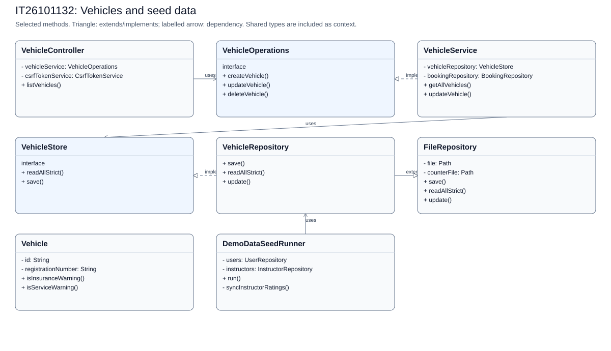
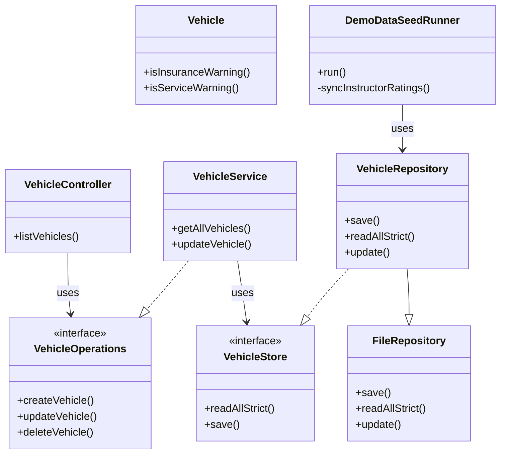

# IT26101132: Vehicles and seed data

[Back to the full speaking guide](README.md). [Class diagram SVG](IT26101132.svg). [Mermaid source](IT26101132.mmd).

Selected classes and methods are shown; shared dependencies are context, not ownership claims. Entities store foreign IDs rather than object compositions.

### 1. What is my module responsible for?

In our system, I use separate classes for the vehicles and seed data module. I keep web requests, rules and storage in separate classes.

**Show in code:** [VehicleController.java](../../src/main/java/com/drivingschool/vehicle/controller/VehicleController.java) - `VehicleController`; [VehicleService.java](../../src/main/java/com/drivingschool/vehicle/service/VehicleService.java) - `VehicleService`.

### 2. Where are Create and Read?

I create through VehicleService using createVehicle and read through VehicleService using getAllVehicles. I let repositories handle files after service checks.

**Show in code:** [VehicleService.java](../../src/main/java/com/drivingschool/vehicle/service/VehicleService.java) - `createVehicle`; [VehicleService.java](../../src/main/java/com/drivingschool/vehicle/service/VehicleService.java) - `getAllVehicles`.

### 3. Where are Update and Delete?

I update through VehicleService using updateVehicle and delete through VehicleService using deleteVehicle. I apply deletion rules instead of breaking saved lesson or payment history.

**Show in code:** [VehicleService.java](../../src/main/java/com/drivingschool/vehicle/service/VehicleService.java) - `updateVehicle`; [VehicleService.java](../../src/main/java/com/drivingschool/vehicle/service/VehicleService.java) - `deleteVehicle`.

### 4. Where did I use encapsulation?

I keep Vehicle fields private and use checked methods to control changes. I use setNextServiceDate to reject invalid values instead of trusting a form.

**Show in code:** [Vehicle.java](../../src/main/java/com/drivingschool/vehicle/model/Vehicle.java) - `setNextServiceDate`.

### 5. Where did I use abstraction?

I expose fleet actions through VehicleOperations. I use VehicleStore for storage tasks instead of putting JSON file code in the controller.

**Show in code:** [VehicleOperations.java](../../src/main/java/com/drivingschool/vehicle/api/VehicleOperations.java) - `class declaration`; [VehicleStore.java](../../src/main/java/com/drivingschool/vehicle/api/VehicleStore.java) - `class declaration`; [VehicleController.java](../../src/main/java/com/drivingschool/vehicle/controller/VehicleController.java) - `VehicleController`.

### 6. Where did I use inheritance?

I make VehicleRepository extend FileRepository to reuse storage, validation and ID counters. I do not copy the JSON writer into Vehicle.

**Show in code:** [VehicleRepository.java](../../src/main/java/com/drivingschool/vehicle/repository/VehicleRepository.java) - `class declaration`.

### 7. Where did I use polymorphism?

I use a VehicleStore reference in VehicleService with VehicleRepository as the actual object. I call its storage methods while keeping the parent file rules.

**Show in code:** [VehicleService.java](../../src/main/java/com/drivingschool/vehicle/service/VehicleService.java) - `VehicleService`; [VehicleRepository.java](../../src/main/java/com/drivingschool/vehicle/repository/VehicleRepository.java) - `save`.

### 8. How did I use exception handling as the fifth course topic?

I use DuplicateRecordException when this module cannot accept a requested change. I let the shared handler explain it safely instead of exposing file details.

**Show in code:** [VehicleService.java](../../src/main/java/com/drivingschool/vehicle/service/VehicleService.java) - `ensureRegistrationNumberIsUnique`; [GlobalExceptionHandler.java](../../src/main/java/com/drivingschool/common/exception/GlobalExceptionHandler.java) - `handleDuplicate`.

### 9. How do I explain Single Responsibility and Open/Closed?

I keep vehicle rules in VehicleService and file writing in VehicleRepository. I can add another typed repository without rewriting the shared FileRepository writer.

**Show in code:** [VehicleService.java](../../src/main/java/com/drivingschool/vehicle/service/VehicleService.java) - `deleteVehicle`; [VehicleRepository.java](../../src/main/java/com/drivingschool/vehicle/repository/VehicleRepository.java) - `class declaration`; [FileRepository.java](../../src/main/java/com/drivingschool/common/repository/FileRepository.java) - `writeRecords`.

### 10. How do I explain Liskov, Interface Segregation and Dependency Inversion?

I delegate VehicleRepository updates to the same parent checks. I give the controller the VehicleOperations fleet contract. I inject that interface instead of constructing VehicleService in the controller.

**Show in code:** [VehicleRepository.java](../../src/main/java/com/drivingschool/vehicle/repository/VehicleRepository.java) - `update`; [VehicleOperations.java](../../src/main/java/com/drivingschool/vehicle/api/VehicleOperations.java) - `class declaration`; [VehicleController.java](../../src/main/java/com/drivingschool/vehicle/controller/VehicleController.java) - `VehicleController`.

### 11. How do I explain Expiry warnings and safe seeding?

I show separate expired or overdue labels and warnings for dates within thirty days. I seed missing records without refilling spent lessons. I use fictional phone and NIC patterns accepted by the app, not real allocated identities.

**Show in code:** [Vehicle.java](../../src/main/java/com/drivingschool/vehicle/model/Vehicle.java) - `isInsuranceWarning`; [Vehicle.java](../../src/main/java/com/drivingschool/vehicle/model/Vehicle.java) - `isServiceWarning`; [DemoDataSeedRunner.java](../../src/main/java/com/drivingschool/sample/DemoDataSeedRunner.java) - `run`.

### 12. What should I demonstrate honestly?

I can demonstrate the vehicles and seed data pages using disposable seeded data. I use server-side rules and tests as evidence, and mark an unconfirmed demonstration NEEDS CHECK.

**Show in code:** [VehicleService.java](../../src/main/java/com/drivingschool/vehicle/service/VehicleService.java) - `VehicleService`.

**Show in browser:** Open Vehicles as admin > Open Edit vehicle for the Alto > Return through Vehicles in the sidebar > Open Edit vehicle for the Honda Dio > Return to Vehicles and inspect warnings.

## Files bearing this member header

- [src/main/java/com/drivingschool/sample/DemoDataSeedRunner.java](../../src/main/java/com/drivingschool/sample/DemoDataSeedRunner.java)
- [src/main/java/com/drivingschool/vehicle/api/VehicleOperations.java](../../src/main/java/com/drivingschool/vehicle/api/VehicleOperations.java)
- [src/main/java/com/drivingschool/vehicle/api/VehicleStore.java](../../src/main/java/com/drivingschool/vehicle/api/VehicleStore.java)
- [src/main/java/com/drivingschool/vehicle/config/VehicleConfig.java](../../src/main/java/com/drivingschool/vehicle/config/VehicleConfig.java)
- [src/main/java/com/drivingschool/vehicle/controller/VehicleController.java](../../src/main/java/com/drivingschool/vehicle/controller/VehicleController.java)
- [src/main/java/com/drivingschool/vehicle/form/VehicleCreateForm.java](../../src/main/java/com/drivingschool/vehicle/form/VehicleCreateForm.java)
- [src/main/java/com/drivingschool/vehicle/form/VehicleEditForm.java](../../src/main/java/com/drivingschool/vehicle/form/VehicleEditForm.java)
- [src/main/java/com/drivingschool/vehicle/model/TransmissionType.java](../../src/main/java/com/drivingschool/vehicle/model/TransmissionType.java)
- [src/main/java/com/drivingschool/vehicle/model/Vehicle.java](../../src/main/java/com/drivingschool/vehicle/model/Vehicle.java)
- [src/main/java/com/drivingschool/vehicle/model/VehicleCategory.java](../../src/main/java/com/drivingschool/vehicle/model/VehicleCategory.java)
- [src/main/java/com/drivingschool/vehicle/model/VehicleOperationalStatus.java](../../src/main/java/com/drivingschool/vehicle/model/VehicleOperationalStatus.java)
- [src/main/java/com/drivingschool/vehicle/repository/VehicleRepository.java](../../src/main/java/com/drivingschool/vehicle/repository/VehicleRepository.java)
- [src/main/java/com/drivingschool/vehicle/service/VehicleService.java](../../src/main/java/com/drivingschool/vehicle/service/VehicleService.java)
- [src/main/webapp/WEB-INF/views/vehicle/create.jsp](../../src/main/webapp/WEB-INF/views/vehicle/create.jsp)
- [src/main/webapp/WEB-INF/views/vehicle/edit.jsp](../../src/main/webapp/WEB-INF/views/vehicle/edit.jsp)
- [src/main/webapp/WEB-INF/views/vehicle/list.jsp](../../src/main/webapp/WEB-INF/views/vehicle/list.jsp)
- [src/test/java/com/drivingschool/sample/DemoDataSeedRunnerTest.java](../../src/test/java/com/drivingschool/sample/DemoDataSeedRunnerTest.java)
- [src/test/java/com/drivingschool/vehicle/VehicleWebIntegrationTest.java](../../src/test/java/com/drivingschool/vehicle/VehicleWebIntegrationTest.java)
- [src/test/java/com/drivingschool/vehicle/config/VehicleConfigTest.java](../../src/test/java/com/drivingschool/vehicle/config/VehicleConfigTest.java)
- [src/test/java/com/drivingschool/vehicle/model/VehicleTest.java](../../src/test/java/com/drivingschool/vehicle/model/VehicleTest.java)
- [src/test/java/com/drivingschool/vehicle/repository/VehicleRepositoryTest.java](../../src/test/java/com/drivingschool/vehicle/repository/VehicleRepositoryTest.java)
- [src/test/java/com/drivingschool/vehicle/service/VehicleMaintenanceTest.java](../../src/test/java/com/drivingschool/vehicle/service/VehicleMaintenanceTest.java)
- [src/test/java/com/drivingschool/vehicle/service/VehicleServiceTest.java](../../src/test/java/com/drivingschool/vehicle/service/VehicleServiceTest.java)

## Custom exceptions to point to

| Exception | Actual source | Meaning |
| --- | --- | --- |
| ValidationException | [Vehicle.java](../../src/main/java/com/drivingschool/vehicle/model/Vehicle.java) - `setNextServiceDate` | Invalid input |
| DuplicateRecordException | [FileRepository.java](../../src/main/java/com/drivingschool/common/repository/FileRepository.java) - `save` | An ID already exists; module helpers also check business duplicates |
| RecordNotFoundException | [FileRepository.java](../../src/main/java/com/drivingschool/common/repository/FileRepository.java) - `update` | The requested stored record is missing |
| StorageException | [FileRepository.java](../../src/main/java/com/drivingschool/common/repository/FileRepository.java) - `readAllStrict` | Damaged or unreadable storage |
