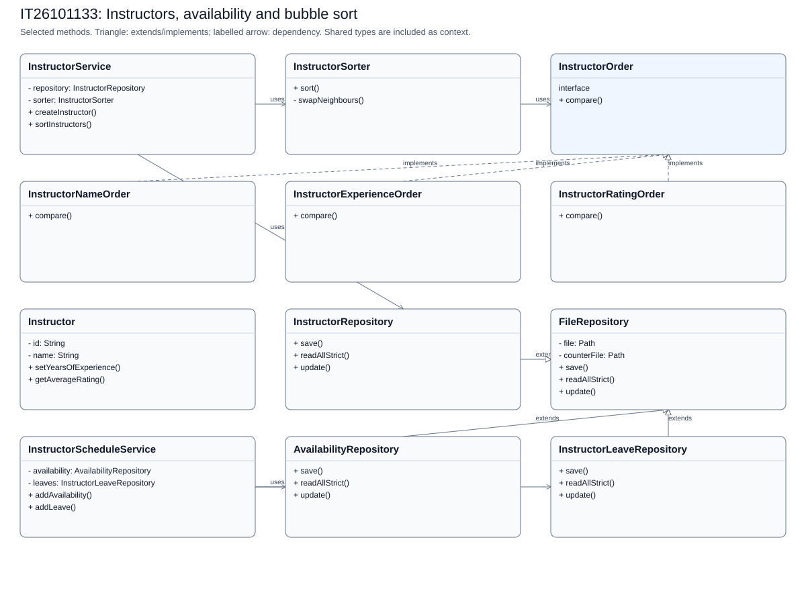
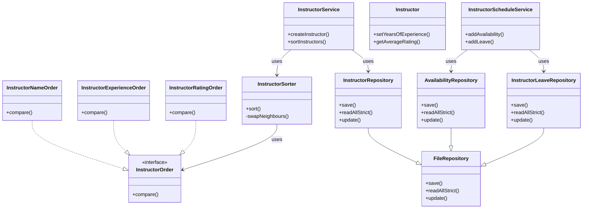

# IT26101133: Instructors, availability and bubble sort

[Back to the full speaking guide](README.md). [Class diagram SVG](IT26101133.svg). [Mermaid source](IT26101133.mmd).

Selected classes and methods are shown; shared dependencies are context, not ownership claims. Entities store foreign IDs rather than object compositions.

### 1. What is my module responsible for?

In our system, I use separate classes for the instructors, availability and bubble sort module. I keep web requests, rules and storage in separate classes.

**Show in code:** [InstructorAvailabilityController.java](../../src/main/java/com/drivingschool/instructor/controller/InstructorAvailabilityController.java) - `InstructorAvailabilityController`; [InstructorService.java](../../src/main/java/com/drivingschool/instructor/service/InstructorService.java) - `InstructorService`.

### 2. Where are Create and Read?

I create through InstructorAccountService using create and read through InstructorService using sortInstructors. I let repositories handle files after service checks.

**Show in code:** [InstructorAccountService.java](../../src/main/java/com/drivingschool/instructor/service/InstructorAccountService.java) - `create`; [InstructorService.java](../../src/main/java/com/drivingschool/instructor/service/InstructorService.java) - `sortInstructors`.

### 3. Where are Update and Delete?

I update through InstructorAccountService using update and delete through InstructorAccountService using delete. I apply deletion rules instead of breaking saved lesson or payment history.

**Show in code:** [InstructorAccountService.java](../../src/main/java/com/drivingschool/instructor/service/InstructorAccountService.java) - `update`; [InstructorAccountService.java](../../src/main/java/com/drivingschool/instructor/service/InstructorAccountService.java) - `delete`.

### 4. Where did I use encapsulation?

I keep Instructor fields private and use checked methods to control changes. I use setYearsOfExperience to reject invalid values instead of trusting a form.

**Show in code:** [Instructor.java](../../src/main/java/com/drivingschool/instructor/model/Instructor.java) - `setYearsOfExperience`.

### 5. Where did I use abstraction?

I use InstructorOrder to describe how two instructors are compared. I let the sorter use that contract rather than put every comparison inside the swap loop.

**Show in code:** [InstructorOrder.java](../../src/main/java/com/drivingschool/instructor/service/InstructorOrder.java) - `compare`; [InstructorSorter.java](../../src/main/java/com/drivingschool/instructor/service/InstructorSorter.java) - `swapNeighbours`.

### 6. Where did I use inheritance?

I make InstructorRepository extend FileRepository for shared file operations. I keep Instructor as a separate profile because it does not extend the account User class.

**Show in code:** [InstructorRepository.java](../../src/main/java/com/drivingschool/instructor/repository/InstructorRepository.java) - `class declaration`; [Instructor.java](../../src/main/java/com/drivingschool/instructor/model/Instructor.java) - `class declaration`.

### 7. Where did I use polymorphism?

I call the same compare method with name, experience or rating comparison objects. I get different decisions while keeping the same bubble-sort passes.

**Show in code:** [InstructorSorter.java](../../src/main/java/com/drivingschool/instructor/service/InstructorSorter.java) - `swapNeighbours`; [InstructorNameOrder.java](../../src/main/java/com/drivingschool/instructor/service/InstructorNameOrder.java) - `compare`; [InstructorExperienceOrder.java](../../src/main/java/com/drivingschool/instructor/service/InstructorExperienceOrder.java) - `compare`; [InstructorRatingOrder.java](../../src/main/java/com/drivingschool/instructor/service/InstructorRatingOrder.java) - `compare`.

### 8. How did I use exception handling as the fifth course topic?

I use DuplicateRecordException when this module cannot accept a requested change. I let the shared handler explain it safely instead of exposing file details.

**Show in code:** [InstructorScheduleService.java](../../src/main/java/com/drivingschool/instructor/service/InstructorScheduleService.java) - `ensureNoOverlap`; [GlobalExceptionHandler.java](../../src/main/java/com/drivingschool/common/exception/GlobalExceptionHandler.java) - `handleDuplicate`.

### 9. How do I explain Single Responsibility and Open/Closed?

I give InstructorSorter only the sorting job. I can add another InstructorOrder without rewriting the swap passes, although chooseOrder must still select the new option.

**Show in code:** [InstructorSorter.java](../../src/main/java/com/drivingschool/instructor/service/InstructorSorter.java) - `sort`; [InstructorSorter.java](../../src/main/java/com/drivingschool/instructor/service/InstructorSorter.java) - `chooseOrder`.

### 10. How do I explain Liskov, Interface Segregation and Dependency Inversion?

I let each InstructorOrder return a negative, zero or positive comparison result. I keep that interface to one compare method. I inject InstructorScheduleOperations into the availability controller.

**Show in code:** [InstructorNameOrder.java](../../src/main/java/com/drivingschool/instructor/service/InstructorNameOrder.java) - `compare`; [InstructorOrder.java](../../src/main/java/com/drivingschool/instructor/service/InstructorOrder.java) - `compare`; [InstructorAvailabilityController.java](../../src/main/java/com/drivingschool/instructor/controller/InstructorAvailabilityController.java) - `InstructorAvailabilityController`.

### 11. How do I explain Bubble sort, steps and complexity?

I compare neighbours and swap them when they are in the wrong order. For ascending [8, 3, 12], I get [3, 8, 12] after the first pass and stop after a pass without swaps. I have O(n squared) worst-case time and O(n) best-case time, plus O(n) space for the copied list.

**Show in code:** [InstructorSorter.java](../../src/main/java/com/drivingschool/instructor/service/InstructorSorter.java) - `sort`; [InstructorSorter.java](../../src/main/java/com/drivingschool/instructor/service/InstructorSorter.java) - `swapNeighbours`.

### 12. What should I demonstrate honestly?

I can demonstrate the instructors, availability and bubble sort pages using disposable seeded data. I use server-side rules and tests as evidence, and mark an unconfirmed demonstration NEEDS CHECK.

**Show in code:** [InstructorService.java](../../src/main/java/com/drivingschool/instructor/service/InstructorService.java) - `InstructorService`.

**Show in browser:** Open Instructors > Select Experience > Choose descending order > Click Sort > Open Packages.

## Files bearing this member header

- [src/main/java/com/drivingschool/instructor/config/InstructorConfig.java](../../src/main/java/com/drivingschool/instructor/config/InstructorConfig.java)
- [src/main/java/com/drivingschool/instructor/controller/InstructorAvailabilityController.java](../../src/main/java/com/drivingschool/instructor/controller/InstructorAvailabilityController.java)
- [src/main/java/com/drivingschool/instructor/controller/InstructorDashboardController.java](../../src/main/java/com/drivingschool/instructor/controller/InstructorDashboardController.java)
- [src/main/java/com/drivingschool/instructor/controller/PublicInstructorController.java](../../src/main/java/com/drivingschool/instructor/controller/PublicInstructorController.java)
- [src/main/java/com/drivingschool/instructor/model/Availability.java](../../src/main/java/com/drivingschool/instructor/model/Availability.java)
- [src/main/java/com/drivingschool/instructor/model/Instructor.java](../../src/main/java/com/drivingschool/instructor/model/Instructor.java)
- [src/main/java/com/drivingschool/instructor/model/InstructorLeave.java](../../src/main/java/com/drivingschool/instructor/model/InstructorLeave.java)
- [src/main/java/com/drivingschool/instructor/model/LessonRecord.java](../../src/main/java/com/drivingschool/instructor/model/LessonRecord.java)
- [src/main/java/com/drivingschool/instructor/repository/AvailabilityRepository.java](../../src/main/java/com/drivingschool/instructor/repository/AvailabilityRepository.java)
- [src/main/java/com/drivingschool/instructor/repository/InstructorLeaveRepository.java](../../src/main/java/com/drivingschool/instructor/repository/InstructorLeaveRepository.java)
- [src/main/java/com/drivingschool/instructor/repository/InstructorRepository.java](../../src/main/java/com/drivingschool/instructor/repository/InstructorRepository.java)
- [src/main/java/com/drivingschool/instructor/repository/LessonRecordRepository.java](../../src/main/java/com/drivingschool/instructor/repository/LessonRecordRepository.java)
- [src/main/java/com/drivingschool/instructor/service/InstructorAccountService.java](../../src/main/java/com/drivingschool/instructor/service/InstructorAccountService.java)
- [src/main/java/com/drivingschool/instructor/service/InstructorCatalog.java](../../src/main/java/com/drivingschool/instructor/service/InstructorCatalog.java)
- [src/main/java/com/drivingschool/instructor/service/InstructorExperienceOrder.java](../../src/main/java/com/drivingschool/instructor/service/InstructorExperienceOrder.java)
- [src/main/java/com/drivingschool/instructor/service/InstructorLessonService.java](../../src/main/java/com/drivingschool/instructor/service/InstructorLessonService.java)
- [src/main/java/com/drivingschool/instructor/service/InstructorNameOrder.java](../../src/main/java/com/drivingschool/instructor/service/InstructorNameOrder.java)
- [src/main/java/com/drivingschool/instructor/service/InstructorOrder.java](../../src/main/java/com/drivingschool/instructor/service/InstructorOrder.java)
- [src/main/java/com/drivingschool/instructor/service/InstructorRatingOrder.java](../../src/main/java/com/drivingschool/instructor/service/InstructorRatingOrder.java)
- [src/main/java/com/drivingschool/instructor/service/InstructorScheduleOperations.java](../../src/main/java/com/drivingschool/instructor/service/InstructorScheduleOperations.java)
- [src/main/java/com/drivingschool/instructor/service/InstructorScheduleService.java](../../src/main/java/com/drivingschool/instructor/service/InstructorScheduleService.java)
- [src/main/java/com/drivingschool/instructor/service/InstructorService.java](../../src/main/java/com/drivingschool/instructor/service/InstructorService.java)
- [src/main/java/com/drivingschool/instructor/service/InstructorSorter.java](../../src/main/java/com/drivingschool/instructor/service/InstructorSorter.java)
- [src/main/webapp/WEB-INF/views/admin/instructors.jsp](../../src/main/webapp/WEB-INF/views/admin/instructors.jsp)
- [src/main/webapp/WEB-INF/views/instructor/availability.jsp](../../src/main/webapp/WEB-INF/views/instructor/availability.jsp)
- [src/main/webapp/WEB-INF/views/instructor/lesson-dashboard.jsp](../../src/main/webapp/WEB-INF/views/instructor/lesson-dashboard.jsp)
- [src/main/webapp/WEB-INF/views/public/instructors.jsp](../../src/main/webapp/WEB-INF/views/public/instructors.jsp)
- [src/test/java/com/drivingschool/instructor/config/InstructorConfigTest.java](../../src/test/java/com/drivingschool/instructor/config/InstructorConfigTest.java)
- [src/test/java/com/drivingschool/instructor/model/InstructorTest.java](../../src/test/java/com/drivingschool/instructor/model/InstructorTest.java)
- [src/test/java/com/drivingschool/instructor/repository/InstructorRepositoryTest.java](../../src/test/java/com/drivingschool/instructor/repository/InstructorRepositoryTest.java)
- [src/test/java/com/drivingschool/instructor/service/InstructorAccountServiceTest.java](../../src/test/java/com/drivingschool/instructor/service/InstructorAccountServiceTest.java)
- [src/test/java/com/drivingschool/instructor/service/InstructorScheduleServiceTest.java](../../src/test/java/com/drivingschool/instructor/service/InstructorScheduleServiceTest.java)
- [src/test/java/com/drivingschool/instructor/service/InstructorServiceTest.java](../../src/test/java/com/drivingschool/instructor/service/InstructorServiceTest.java)
- [src/test/java/com/drivingschool/instructor/service/InstructorSorterTest.java](../../src/test/java/com/drivingschool/instructor/service/InstructorSorterTest.java)

## Worked bubble-sort trace

Ascending example using [8, 3, 12]:

| Step | Comparison | Action | Values |
| --- | --- | --- | --- |
| Pass 1, pair 1 | 8 and 3 | Swap | 3, 8, 12 |
| Pass 1, pair 2 | 8 and 12 | Keep | 3, 8, 12 |
| Pass 2, pair 1 | 3 and 8 | Keep; no swaps in pass, stop | 3, 8, 12 |

The actual six-person descending example gives Pasindu (15), Piravarshini (12), Shahithiyan (8), Ruwini (5), Pragash (3), Sayumi (2). Worst time O(n squared), best O(n) with early exit; adjacent swaps use O(1) extra space but this method also copies the input list, so total extra space is O(n).

## Custom exceptions to point to

| Exception | Actual source | Meaning |
| --- | --- | --- |
| ValidationException | [Instructor.java](../../src/main/java/com/drivingschool/instructor/model/Instructor.java) - `setYearsOfExperience` | Invalid input |
| DuplicateRecordException | [FileRepository.java](../../src/main/java/com/drivingschool/common/repository/FileRepository.java) - `save` | An ID already exists; module helpers also check business duplicates |
| RecordNotFoundException | [FileRepository.java](../../src/main/java/com/drivingschool/common/repository/FileRepository.java) - `update` | The requested stored record is missing |
| StorageException | [FileRepository.java](../../src/main/java/com/drivingschool/common/repository/FileRepository.java) - `readAllStrict` | Damaged or unreadable storage |

## Availability and leave CRUD

InstructorScheduleService has addAvailability, availability, updateAvailability and deleteAvailability. Its leave equivalents are addLeave, leaves, updateLeave and deleteLeave. Show in code: [InstructorScheduleService.java](../../src/main/java/com/drivingschool/instructor/service/InstructorScheduleService.java), those methods. Confirmed lessons protect working-hour edits and deletion. Leave is also blocked by assigned pending lessons; ask an administrator to resolve them first. Schedule writes share the existing booking/account lock.
