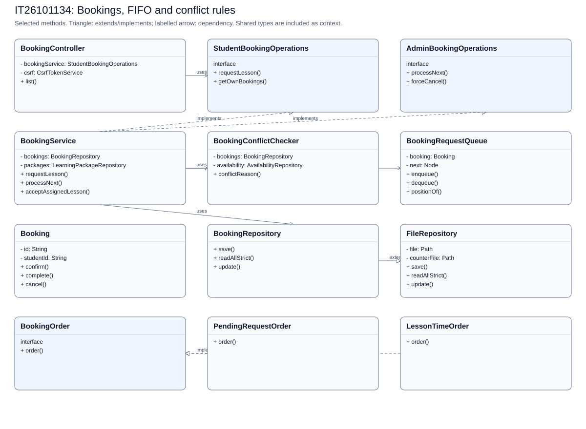
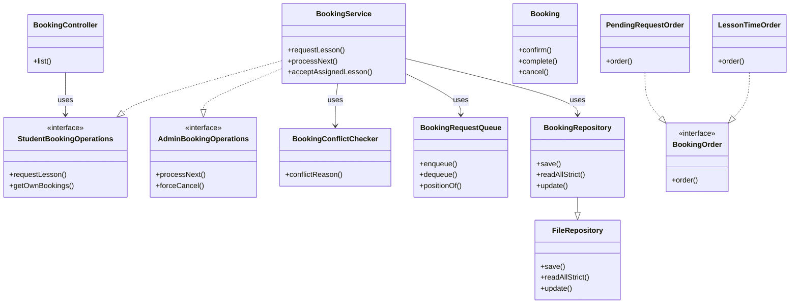

# IT26101134: Bookings, FIFO and conflict rules

[Back to the full speaking guide](README.md). [Class diagram SVG](IT26101134.svg). [Mermaid source](IT26101134.mmd).

Selected classes and methods are shown; shared dependencies are context, not ownership claims. Entities store foreign IDs rather than object compositions.

### 1. What is my module responsible for?

In our system, I use separate classes for the bookings, fifo and conflict rules module. I keep web requests, rules and storage in separate classes.

**Show in code:** [BookingController.java](../../src/main/java/com/drivingschool/booking/controller/BookingController.java) - `BookingController`; [BookingService.java](../../src/main/java/com/drivingschool/booking/service/BookingService.java) - `BookingService`.

### 2. Where are Create and Read?

I create through BookingService using requestLesson and read through BookingService using getOwnBookings. I let repositories handle files after service checks.

**Show in code:** [BookingService.java](../../src/main/java/com/drivingschool/booking/service/BookingService.java) - `requestLesson`; [BookingService.java](../../src/main/java/com/drivingschool/booking/service/BookingService.java) - `getOwnBookings`.

### 3. Where are Update and Delete?

I update through BookingService using rescheduleOwnBooking and delete through BookingService using deleteCancelledBooking. I apply deletion rules instead of breaking saved lesson or payment history.

**Show in code:** [BookingService.java](../../src/main/java/com/drivingschool/booking/service/BookingService.java) - `rescheduleOwnBooking`; [BookingService.java](../../src/main/java/com/drivingschool/booking/service/BookingService.java) - `deleteCancelledBooking`.

### 4. Where did I use encapsulation?

I keep Booking fields private and use checked methods to control changes. I use Booking to reject invalid values instead of trusting a form.

**Show in code:** [Booking.java](../../src/main/java/com/drivingschool/booking/model/Booking.java) - `Booking`.

### 5. Where did I use abstraction?

I separate StudentBookingOperations from AdminBookingOperations. I describe list ordering through BookingOrder without exposing the queue nodes.

**Show in code:** [StudentBookingOperations.java](../../src/main/java/com/drivingschool/booking/service/StudentBookingOperations.java) - `class declaration`; [AdminBookingOperations.java](../../src/main/java/com/drivingschool/booking/service/AdminBookingOperations.java) - `class declaration`; [BookingOrder.java](../../src/main/java/com/drivingschool/booking/util/BookingOrder.java) - `order`.

### 6. Where did I use inheritance?

I make BookingRepository extend FileRepository for shared storage. I use a private linked Node inside the queue rather than claiming the queue inherits from Booking.

**Show in code:** [BookingRepository.java](../../src/main/java/com/drivingschool/booking/repository/BookingRepository.java) - `class declaration`; [BookingRequestQueue.java](../../src/main/java/com/drivingschool/booking/util/BookingRequestQueue.java) - `class declaration`.

### 7. Where did I use polymorphism?

I call order through BookingOrder references for pending-request and lesson-time views. I remember that the pending view also filters requests, so those views do not have identical business meanings.

**Show in code:** [BookingService.java](../../src/main/java/com/drivingschool/booking/service/BookingService.java) - `getAllBookings`; [PendingRequestOrder.java](../../src/main/java/com/drivingschool/booking/util/PendingRequestOrder.java) - `order`; [LessonTimeOrder.java](../../src/main/java/com/drivingschool/booking/util/LessonTimeOrder.java) - `order`.

### 8. How did I use exception handling as the fifth course topic?

I use ValidationException when this module cannot accept a requested change. I let the shared handler explain it safely instead of exposing file details.

**Show in code:** [BookingService.java](../../src/main/java/com/drivingschool/booking/service/BookingService.java) - `parseFilterDate`; [GlobalExceptionHandler.java](../../src/main/java/com/drivingschool/common/exception/GlobalExceptionHandler.java) - `handleValidation`.

### 9. How do I explain Single Responsibility and Open/Closed?

I keep conflict checks in BookingConflictChecker and waiting order in BookingRequestQueue. I can add another BookingOrder without rewriting the existing ordering classes, but the caller must choose the right view.

**Show in code:** [BookingConflictChecker.java](../../src/main/java/com/drivingschool/booking/service/BookingConflictChecker.java) - `conflictReason`; [BookingOrder.java](../../src/main/java/com/drivingschool/booking/util/BookingOrder.java) - `order`.

### 10. How do I explain Liskov, Interface Segregation and Dependency Inversion?

I preserve the shared save contract in BookingRepository. I separate student and admin booking contracts. I inject StudentBookingOperations into BookingController.

**Show in code:** [BookingRepository.java](../../src/main/java/com/drivingschool/booking/repository/BookingRepository.java) - `save`; [StudentBookingOperations.java](../../src/main/java/com/drivingschool/booking/service/StudentBookingOperations.java) - `class declaration`; [BookingController.java](../../src/main/java/com/drivingschool/booking/controller/BookingController.java) - `BookingController`.

### 11. How do I explain FIFO, enqueue, dequeue and complexity?

I enqueue at the tail and dequeue the oldest head, each in O(1) time. I use FIFO so later unassigned requests do not jump ahead. I rebuild the queue with stable insertion sorting, which can take O(n squared), and position lookup takes O(n).

**Show in code:** [BookingRequestQueue.java](../../src/main/java/com/drivingschool/booking/util/BookingRequestQueue.java) - `enqueue`; [BookingRequestQueue.java](../../src/main/java/com/drivingschool/booking/util/BookingRequestQueue.java) - `dequeue`; [BookingRequestQueue.java](../../src/main/java/com/drivingschool/booking/util/BookingRequestQueue.java) - `positionOf`; [BookingService.java](../../src/main/java/com/drivingschool/booking/service/BookingService.java) - `processNext`.

### 12. What should I demonstrate honestly?

I can demonstrate the bookings, fifo and conflict rules pages using disposable seeded data. I use server-side rules and tests as evidence, and mark an unconfirmed demonstration NEEDS CHECK.

**Show in code:** [BookingService.java](../../src/main/java/com/drivingschool/booking/service/BookingService.java) - `BookingService`.

**Show in browser:** Open My lessons as student1 > Open the first booking details > Inspect its waiting-list position > Click Back to bookings > Open History.

## Files bearing this member header

- [src/main/java/com/drivingschool/booking/controller/AdminBookingController.java](../../src/main/java/com/drivingschool/booking/controller/AdminBookingController.java)
- [src/main/java/com/drivingschool/booking/controller/AttendancePresentationAdvice.java](../../src/main/java/com/drivingschool/booking/controller/AttendancePresentationAdvice.java)
- [src/main/java/com/drivingschool/booking/controller/BookingController.java](../../src/main/java/com/drivingschool/booking/controller/BookingController.java)
- [src/main/java/com/drivingschool/booking/controller/BookingDetailsController.java](../../src/main/java/com/drivingschool/booking/controller/BookingDetailsController.java)
- [src/main/java/com/drivingschool/booking/model/Booking.java](../../src/main/java/com/drivingschool/booking/model/Booking.java)
- [src/main/java/com/drivingschool/booking/model/BookingStatus.java](../../src/main/java/com/drivingschool/booking/model/BookingStatus.java)
- [src/main/java/com/drivingschool/booking/repository/BookingRepository.java](../../src/main/java/com/drivingschool/booking/repository/BookingRepository.java)
- [src/main/java/com/drivingschool/booking/service/AdminBookingOperations.java](../../src/main/java/com/drivingschool/booking/service/AdminBookingOperations.java)
- [src/main/java/com/drivingschool/booking/service/BookingConflictChecker.java](../../src/main/java/com/drivingschool/booking/service/BookingConflictChecker.java)
- [src/main/java/com/drivingschool/booking/service/BookingService.java](../../src/main/java/com/drivingschool/booking/service/BookingService.java)
- [src/main/java/com/drivingschool/booking/service/PaidEnrollmentGuard.java](../../src/main/java/com/drivingschool/booking/service/PaidEnrollmentGuard.java)
- [src/main/java/com/drivingschool/booking/service/SlotAvailabilityService.java](../../src/main/java/com/drivingschool/booking/service/SlotAvailabilityService.java)
- [src/main/java/com/drivingschool/booking/service/StudentBookingOperations.java](../../src/main/java/com/drivingschool/booking/service/StudentBookingOperations.java)
- [src/main/java/com/drivingschool/booking/util/BookingOrder.java](../../src/main/java/com/drivingschool/booking/util/BookingOrder.java)
- [src/main/java/com/drivingschool/booking/util/BookingRequestQueue.java](../../src/main/java/com/drivingschool/booking/util/BookingRequestQueue.java)
- [src/main/java/com/drivingschool/booking/util/LessonIntervalUtils.java](../../src/main/java/com/drivingschool/booking/util/LessonIntervalUtils.java)
- [src/main/java/com/drivingschool/booking/util/LessonTimeOrder.java](../../src/main/java/com/drivingschool/booking/util/LessonTimeOrder.java)
- [src/main/java/com/drivingschool/booking/util/PendingRequestOrder.java](../../src/main/java/com/drivingschool/booking/util/PendingRequestOrder.java)
- [src/main/webapp/WEB-INF/views/admin/booking-card.jspf](../../src/main/webapp/WEB-INF/views/admin/booking-card.jspf)
- [src/main/webapp/WEB-INF/views/admin/bookings.jsp](../../src/main/webapp/WEB-INF/views/admin/bookings.jsp)
- [src/main/webapp/WEB-INF/views/booking/details.jsp](../../src/main/webapp/WEB-INF/views/booking/details.jsp)
- [src/main/webapp/WEB-INF/views/booking/list.jsp](../../src/main/webapp/WEB-INF/views/booking/list.jsp)
- [src/main/webapp/WEB-INF/views/booking/request-card.jspf](../../src/main/webapp/WEB-INF/views/booking/request-card.jspf)
- [src/main/webapp/WEB-INF/views/common/components/attendance-time.jspf](../../src/main/webapp/WEB-INF/views/common/components/attendance-time.jspf)
- [src/test/java/com/drivingschool/booking/AttendancePresentationAdviceTest.java](../../src/test/java/com/drivingschool/booking/AttendancePresentationAdviceTest.java)
- [src/test/java/com/drivingschool/booking/SchedulingWebIntegrationTest.java](../../src/test/java/com/drivingschool/booking/SchedulingWebIntegrationTest.java)
- [src/test/java/com/drivingschool/booking/model/BookingTest.java](../../src/test/java/com/drivingschool/booking/model/BookingTest.java)
- [src/test/java/com/drivingschool/booking/repository/BookingRepositorySpringIntegrationTest.java](../../src/test/java/com/drivingschool/booking/repository/BookingRepositorySpringIntegrationTest.java)
- [src/test/java/com/drivingschool/booking/repository/BookingRepositoryTest.java](../../src/test/java/com/drivingschool/booking/repository/BookingRepositoryTest.java)
- [src/test/java/com/drivingschool/booking/service/BookingConflictCheckerTest.java](../../src/test/java/com/drivingschool/booking/service/BookingConflictCheckerTest.java)
- [src/test/java/com/drivingschool/booking/service/BookingCutoffTest.java](../../src/test/java/com/drivingschool/booking/service/BookingCutoffTest.java)
- [src/test/java/com/drivingschool/booking/service/BookingServiceCrudTest.java](../../src/test/java/com/drivingschool/booking/service/BookingServiceCrudTest.java)
- [src/test/java/com/drivingschool/booking/service/SlotAvailabilityServiceTest.java](../../src/test/java/com/drivingschool/booking/service/SlotAvailabilityServiceTest.java)
- [src/test/java/com/drivingschool/booking/service/SlotBoundaryTest.java](../../src/test/java/com/drivingschool/booking/service/SlotBoundaryTest.java)
- [src/test/java/com/drivingschool/booking/util/BookingOrderTest.java](../../src/test/java/com/drivingschool/booking/util/BookingOrderTest.java)
- [src/test/java/com/drivingschool/booking/util/BookingRequestQueueTest.java](../../src/test/java/com/drivingschool/booking/util/BookingRequestQueueTest.java)
- [src/test/java/com/drivingschool/booking/util/LessonIntervalUtilsTest.java](../../src/test/java/com/drivingschool/booking/util/LessonIntervalUtilsTest.java)

## FIFO trace

| Operation | Head to tail | Result |
| --- | --- | --- |
| enqueue B001 | B001 | head and tail are B001 |
| enqueue B002 | B001, B002 | tail becomes B002 |
| dequeue | B002 | returns B001; head becomes B002 |
| dequeue | empty | returns B002; head and tail become null |

The constructor filters pending unassigned requests, stable-sorts by createdAt, then links nodes. Assigned pending B003 is outside this queue. Processing saves assignment/rejection through BookingService; dequeue alone only changes the in-memory view.

## Custom exceptions to point to

| Exception | Actual source | Meaning |
| --- | --- | --- |
| ValidationException | [Booking.java](../../src/main/java/com/drivingschool/booking/model/Booking.java) - `Booking` | Invalid input |
| DuplicateRecordException | [FileRepository.java](../../src/main/java/com/drivingschool/common/repository/FileRepository.java) - `save` | An ID already exists; module helpers also check business duplicates |
| RecordNotFoundException | [FileRepository.java](../../src/main/java/com/drivingschool/common/repository/FileRepository.java) - `update` | The requested stored record is missing |
| StorageException | [FileRepository.java](../../src/main/java/com/drivingschool/common/repository/FileRepository.java) - `readAllStrict` | Damaged or unreadable storage |
