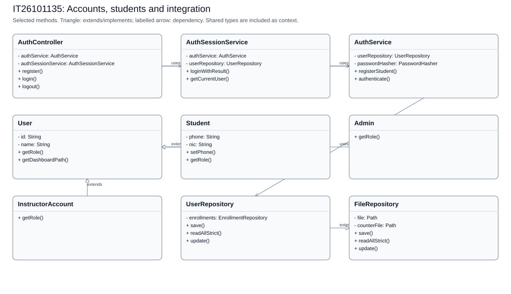
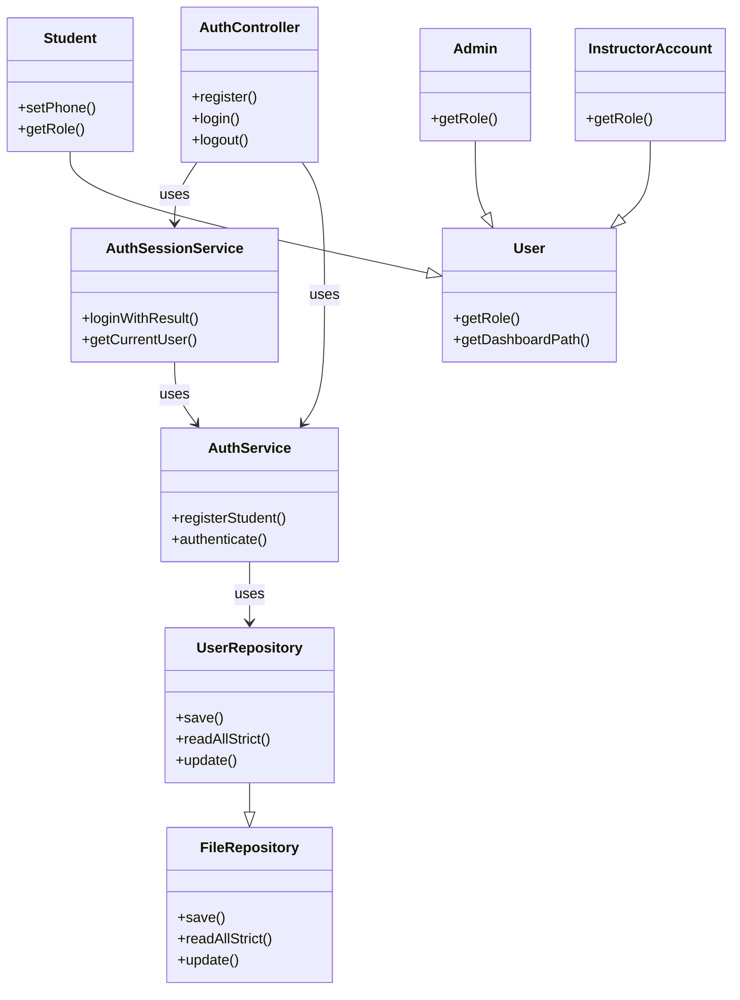

# IT26101135: Accounts, students and integration

[Back to the full speaking guide](README.md). [Class diagram SVG](IT26101135.svg). [Mermaid source](IT26101135.mmd).

Selected classes and methods are shown; shared dependencies are context, not ownership claims. Entities store foreign IDs rather than object compositions.

### 1. What is my module responsible for?

In our system, I use separate classes for the accounts, students and integration module. I keep web requests, rules and storage in separate classes.

**Show in code:** [StudentProfileController.java](../../src/main/java/com/drivingschool/student/controller/StudentProfileController.java) - `StudentProfileController`; [StudentProfileService.java](../../src/main/java/com/drivingschool/student/service/StudentProfileService.java) - `StudentProfileService`.

### 2. Where are Create and Read?

I create through AuthService using registerStudent and read through StudentProfileService using getOwnProfile. I let repositories handle files after service checks.

**Show in code:** [AuthService.java](../../src/main/java/com/drivingschool/auth/service/AuthService.java) - `registerStudent`; [StudentProfileService.java](../../src/main/java/com/drivingschool/student/service/StudentProfileService.java) - `getOwnProfile`.

### 3. Where are Update and Delete?

I update through StudentProfileService using updateOwnProfile and delete through StudentAccountService using deleteOwnAccount. I apply deletion rules instead of breaking saved lesson or payment history.

**Show in code:** [StudentProfileService.java](../../src/main/java/com/drivingschool/student/service/StudentProfileService.java) - `updateOwnProfile`; [StudentAccountService.java](../../src/main/java/com/drivingschool/student/service/StudentAccountService.java) - `deleteOwnAccount`.

### 4. Where did I use encapsulation?

I keep Student fields private and use checked methods to control changes. I use setPhone to reject invalid values instead of trusting a form.

**Show in code:** [Student.java](../../src/main/java/com/drivingschool/student/model/Student.java) - `setPhone`.

### 5. Where did I use abstraction?

I use abstract User for common account details. I require each account child to supply its own role and dashboard path.

**Show in code:** [User.java](../../src/main/java/com/drivingschool/auth/model/User.java) - `getRole`; [User.java](../../src/main/java/com/drivingschool/auth/model/User.java) - `getDashboardPath`.

### 6. Where did I use inheritance?

I make Student extend User so it reuses account name, email and password-hash rules. I use Admin and InstructorAccount as other User children.

**Show in code:** [Student.java](../../src/main/java/com/drivingschool/student/model/Student.java) - `class declaration`; [Admin.java](../../src/main/java/com/drivingschool/auth/model/Admin.java) - `class declaration`; [InstructorAccount.java](../../src/main/java/com/drivingschool/auth/model/InstructorAccount.java) - `class declaration`.

### 7. Where did I use polymorphism?

I call getDashboardPath through a User reference after login. I get the student, instructor or admin destination from the actual account class.

**Show in code:** [AuthController.java](../../src/main/java/com/drivingschool/auth/controller/AuthController.java) - `login`; [User.java](../../src/main/java/com/drivingschool/auth/model/User.java) - `getDashboardPath`.

### 8. How did I use exception handling as the fifth course topic?

I use DuplicateRecordException when this module cannot accept a requested change. I let the shared handler explain it safely instead of exposing file details.

**Show in code:** [StudentProfileService.java](../../src/main/java/com/drivingschool/student/service/StudentProfileService.java) - `ensureAvailableEmail`; [GlobalExceptionHandler.java](../../src/main/java/com/drivingschool/common/exception/GlobalExceptionHandler.java) - `handleDuplicate`.

### 9. How do I explain Single Responsibility and Open/Closed?

I keep profile HTTP handling in StudentProfileController and rules in StudentProfileService. I can add a User child without rewriting existing children, but a new role still needs enum and access changes.

**Show in code:** [StudentProfileController.java](../../src/main/java/com/drivingschool/student/controller/StudentProfileController.java) - `updateProfile`; [User.java](../../src/main/java/com/drivingschool/auth/model/User.java) - `class declaration`.

### 10. How do I explain Liskov, Interface Segregation and Dependency Inversion?

I can use Student as User while keeping a valid role and destination. I give profile pages the smaller StudentProfiles contract. I inject that interface into StudentProfileController rather than constructing its service there.

**Show in code:** [Student.java](../../src/main/java/com/drivingschool/student/model/Student.java) - `getRole`; [StudentProfiles.java](../../src/main/java/com/drivingschool/student/api/StudentProfiles.java) - `getOwnProfile`; [StudentProfileController.java](../../src/main/java/com/drivingschool/student/controller/StudentProfileController.java) - `StudentProfileController`.

### 11. How do I explain Registration, login and sessions?

I register a student as Active with a unique email and hashed password. I create a session only after the password and account status pass. I keep payment eligibility separate from account registration.

**Show in code:** [AuthService.java](../../src/main/java/com/drivingschool/auth/service/AuthService.java) - `registerStudent`; [AuthSessionService.java](../../src/main/java/com/drivingschool/auth/service/AuthSessionService.java) - `loginWithResult`.

### 12. What should I demonstrate honestly?

I can demonstrate the accounts, students and integration pages using disposable seeded data. I use server-side rules and tests as evidence, and mark an unconfirmed demonstration NEEDS CHECK.

**Show in code:** [StudentProfileService.java](../../src/main/java/com/drivingschool/student/service/StudentProfileService.java) - `StudentProfileService`.

**Show in browser:** Open Register from the login page > Return using Log in > Log in as student1 > Open Account settings > Open Change password without submitting.

## Files bearing this member header

- [src/main/java/com/drivingschool/DrivesparkAcademyApplication.java](../../src/main/java/com/drivingschool/DrivesparkAcademyApplication.java)
- [src/main/java/com/drivingschool/ServletInitializer.java](../../src/main/java/com/drivingschool/ServletInitializer.java)
- [src/main/java/com/drivingschool/admin/controller/AdminDashboardController.java](../../src/main/java/com/drivingschool/admin/controller/AdminDashboardController.java)
- [src/main/java/com/drivingschool/admin/controller/AdminManagementController.java](../../src/main/java/com/drivingschool/admin/controller/AdminManagementController.java)
- [src/main/java/com/drivingschool/auth/annotation/RequireAdmin.java](../../src/main/java/com/drivingschool/auth/annotation/RequireAdmin.java)
- [src/main/java/com/drivingschool/auth/annotation/RequireLogin.java](../../src/main/java/com/drivingschool/auth/annotation/RequireLogin.java)
- [src/main/java/com/drivingschool/auth/config/AdminSeedRunner.java](../../src/main/java/com/drivingschool/auth/config/AdminSeedRunner.java)
- [src/main/java/com/drivingschool/auth/controller/AuthController.java](../../src/main/java/com/drivingschool/auth/controller/AuthController.java)
- [src/main/java/com/drivingschool/auth/controller/PasswordController.java](../../src/main/java/com/drivingschool/auth/controller/PasswordController.java)
- [src/main/java/com/drivingschool/auth/filter/CsrfFilter.java](../../src/main/java/com/drivingschool/auth/filter/CsrfFilter.java)
- [src/main/java/com/drivingschool/auth/form/LoginForm.java](../../src/main/java/com/drivingschool/auth/form/LoginForm.java)
- [src/main/java/com/drivingschool/auth/form/RegistrationForm.java](../../src/main/java/com/drivingschool/auth/form/RegistrationForm.java)
- [src/main/java/com/drivingschool/auth/interceptor/AccessInterceptor.java](../../src/main/java/com/drivingschool/auth/interceptor/AccessInterceptor.java)
- [src/main/java/com/drivingschool/auth/interceptor/NavigationInterceptor.java](../../src/main/java/com/drivingschool/auth/interceptor/NavigationInterceptor.java)
- [src/main/java/com/drivingschool/auth/model/AccountStatus.java](../../src/main/java/com/drivingschool/auth/model/AccountStatus.java)
- [src/main/java/com/drivingschool/auth/model/Admin.java](../../src/main/java/com/drivingschool/auth/model/Admin.java)
- [src/main/java/com/drivingschool/auth/model/InstructorAccount.java](../../src/main/java/com/drivingschool/auth/model/InstructorAccount.java)
- [src/main/java/com/drivingschool/auth/model/Role.java](../../src/main/java/com/drivingschool/auth/model/Role.java)
- [src/main/java/com/drivingschool/auth/model/User.java](../../src/main/java/com/drivingschool/auth/model/User.java)
- [src/main/java/com/drivingschool/auth/repository/UserRepository.java](../../src/main/java/com/drivingschool/auth/repository/UserRepository.java)
- [src/main/java/com/drivingschool/auth/service/AdminSeedService.java](../../src/main/java/com/drivingschool/auth/service/AdminSeedService.java)
- [src/main/java/com/drivingschool/auth/service/AuthService.java](../../src/main/java/com/drivingschool/auth/service/AuthService.java)
- [src/main/java/com/drivingschool/auth/service/AuthSessionService.java](../../src/main/java/com/drivingschool/auth/service/AuthSessionService.java)
- [src/main/java/com/drivingschool/auth/service/CsrfTokenService.java](../../src/main/java/com/drivingschool/auth/service/CsrfTokenService.java)
- [src/main/java/com/drivingschool/auth/service/LoginResult.java](../../src/main/java/com/drivingschool/auth/service/LoginResult.java)
- [src/main/java/com/drivingschool/auth/service/PasswordManagementService.java](../../src/main/java/com/drivingschool/auth/service/PasswordManagementService.java)
- [src/main/java/com/drivingschool/auth/util/AccountWriteCoordinator.java](../../src/main/java/com/drivingschool/auth/util/AccountWriteCoordinator.java)
- [src/main/java/com/drivingschool/auth/util/PasswordHasher.java](../../src/main/java/com/drivingschool/auth/util/PasswordHasher.java)
- [src/main/java/com/drivingschool/common/config/CustomErrorViewResolver.java](../../src/main/java/com/drivingschool/common/config/CustomErrorViewResolver.java)
- [src/main/java/com/drivingschool/common/config/WebConfig.java](../../src/main/java/com/drivingschool/common/config/WebConfig.java)
- [src/main/java/com/drivingschool/common/controller/AccountDisplayAdvice.java](../../src/main/java/com/drivingschool/common/controller/AccountDisplayAdvice.java)
- [src/main/java/com/drivingschool/common/controller/HomeController.java](../../src/main/java/com/drivingschool/common/controller/HomeController.java)
- [src/main/java/com/drivingschool/common/controller/PublicPagesController.java](../../src/main/java/com/drivingschool/common/controller/PublicPagesController.java)
- [src/main/java/com/drivingschool/common/controller/SchoolPresentationAdvice.java](../../src/main/java/com/drivingschool/common/controller/SchoolPresentationAdvice.java)
- [src/main/java/com/drivingschool/common/controller/SetupController.java](../../src/main/java/com/drivingschool/common/controller/SetupController.java)
- [src/main/java/com/drivingschool/common/exception/DuplicateRecordException.java](../../src/main/java/com/drivingschool/common/exception/DuplicateRecordException.java)
- [src/main/java/com/drivingschool/common/exception/ErrorPageSupport.java](../../src/main/java/com/drivingschool/common/exception/ErrorPageSupport.java)
- [src/main/java/com/drivingschool/common/exception/GlobalExceptionHandler.java](../../src/main/java/com/drivingschool/common/exception/GlobalExceptionHandler.java)
- [src/main/java/com/drivingschool/common/exception/RecordNotFoundException.java](../../src/main/java/com/drivingschool/common/exception/RecordNotFoundException.java)
- [src/main/java/com/drivingschool/common/exception/StorageException.java](../../src/main/java/com/drivingschool/common/exception/StorageException.java)
- [src/main/java/com/drivingschool/common/exception/ValidationException.java](../../src/main/java/com/drivingschool/common/exception/ValidationException.java)
- [src/main/java/com/drivingschool/common/model/ContactMessage.java](../../src/main/java/com/drivingschool/common/model/ContactMessage.java)
- [src/main/java/com/drivingschool/common/model/DashboardSummary.java](../../src/main/java/com/drivingschool/common/model/DashboardSummary.java)
- [src/main/java/com/drivingschool/common/model/Identifiable.java](../../src/main/java/com/drivingschool/common/model/Identifiable.java)
- [src/main/java/com/drivingschool/common/repository/ContactMessageRepository.java](../../src/main/java/com/drivingschool/common/repository/ContactMessageRepository.java)
- [src/main/java/com/drivingschool/common/repository/FileRepository.java](../../src/main/java/com/drivingschool/common/repository/FileRepository.java)
- [src/main/java/com/drivingschool/common/service/ContactService.java](../../src/main/java/com/drivingschool/common/service/ContactService.java)
- [src/main/java/com/drivingschool/common/service/DashboardSummaryProvider.java](../../src/main/java/com/drivingschool/common/service/DashboardSummaryProvider.java)
- [src/main/java/com/drivingschool/common/service/DashboardSummaryService.java](../../src/main/java/com/drivingschool/common/service/DashboardSummaryService.java)
- [src/main/java/com/drivingschool/common/util/IdGenerator.java](../../src/main/java/com/drivingschool/common/util/IdGenerator.java)
- [src/main/java/com/drivingschool/student/api/StudentLookup.java](../../src/main/java/com/drivingschool/student/api/StudentLookup.java)
- [src/main/java/com/drivingschool/student/api/StudentProfiles.java](../../src/main/java/com/drivingschool/student/api/StudentProfiles.java)
- [src/main/java/com/drivingschool/student/controller/StudentAccountController.java](../../src/main/java/com/drivingschool/student/controller/StudentAccountController.java)
- [src/main/java/com/drivingschool/student/controller/StudentPasswordController.java](../../src/main/java/com/drivingschool/student/controller/StudentPasswordController.java)
- [src/main/java/com/drivingschool/student/controller/StudentProfileController.java](../../src/main/java/com/drivingschool/student/controller/StudentProfileController.java)
- [src/main/java/com/drivingschool/student/controller/StudentProgressController.java](../../src/main/java/com/drivingschool/student/controller/StudentProgressController.java)
- [src/main/java/com/drivingschool/student/dto/StudentProfile.java](../../src/main/java/com/drivingschool/student/dto/StudentProfile.java)
- [src/main/java/com/drivingschool/student/dto/StudentProgress.java](../../src/main/java/com/drivingschool/student/dto/StudentProgress.java)
- [src/main/java/com/drivingschool/student/dto/StudentSummary.java](../../src/main/java/com/drivingschool/student/dto/StudentSummary.java)
- [src/main/java/com/drivingschool/student/form/StudentProfileForm.java](../../src/main/java/com/drivingschool/student/form/StudentProfileForm.java)
- [src/main/java/com/drivingschool/student/model/Student.java](../../src/main/java/com/drivingschool/student/model/Student.java)
- [src/main/java/com/drivingschool/student/service/StudentAccountService.java](../../src/main/java/com/drivingschool/student/service/StudentAccountService.java)
- [src/main/java/com/drivingschool/student/service/StudentAdministrationService.java](../../src/main/java/com/drivingschool/student/service/StudentAdministrationService.java)
- [src/main/java/com/drivingschool/student/service/StudentLookupService.java](../../src/main/java/com/drivingschool/student/service/StudentLookupService.java)
- [src/main/java/com/drivingschool/student/service/StudentProfileService.java](../../src/main/java/com/drivingschool/student/service/StudentProfileService.java)
- [src/main/webapp/WEB-INF/views/admin/dashboard.jsp](../../src/main/webapp/WEB-INF/views/admin/dashboard.jsp)
- [src/main/webapp/WEB-INF/views/admin/students.jsp](../../src/main/webapp/WEB-INF/views/admin/students.jsp)
- [src/main/webapp/WEB-INF/views/auth/forgot-password.jsp](../../src/main/webapp/WEB-INF/views/auth/forgot-password.jsp)
- [src/main/webapp/WEB-INF/views/auth/login.jsp](../../src/main/webapp/WEB-INF/views/auth/login.jsp)
- [src/main/webapp/WEB-INF/views/auth/register.jsp](../../src/main/webapp/WEB-INF/views/auth/register.jsp)
- [src/main/webapp/WEB-INF/views/common/error-403.jsp](../../src/main/webapp/WEB-INF/views/common/error-403.jsp)
- [src/main/webapp/WEB-INF/views/common/error-404.jsp](../../src/main/webapp/WEB-INF/views/common/error-404.jsp)
- [src/main/webapp/WEB-INF/views/common/error-500.jsp](../../src/main/webapp/WEB-INF/views/common/error-500.jsp)
- [src/main/webapp/WEB-INF/views/home/index.jsp](../../src/main/webapp/WEB-INF/views/home/index.jsp)
- [src/main/webapp/WEB-INF/views/student/password.jsp](../../src/main/webapp/WEB-INF/views/student/password.jsp)
- [src/main/webapp/WEB-INF/views/student/profile-edit.jsp](../../src/main/webapp/WEB-INF/views/student/profile-edit.jsp)
- [src/main/webapp/WEB-INF/views/student/profile.jsp](../../src/main/webapp/WEB-INF/views/student/profile.jsp)
- [src/main/webapp/WEB-INF/views/student/progress.jsp](../../src/main/webapp/WEB-INF/views/student/progress.jsp)
- [src/test/java/com/drivingschool/admin/AdminDashboardWebIntegrationTest.java](../../src/test/java/com/drivingschool/admin/AdminDashboardWebIntegrationTest.java)
- [src/test/java/com/drivingschool/auth/AuthWebIntegrationTest.java](../../src/test/java/com/drivingschool/auth/AuthWebIntegrationTest.java)
- [src/test/java/com/drivingschool/auth/config/AdminSeedRunnerTest.java](../../src/test/java/com/drivingschool/auth/config/AdminSeedRunnerTest.java)
- [src/test/java/com/drivingschool/auth/controller/AuthControllerTest.java](../../src/test/java/com/drivingschool/auth/controller/AuthControllerTest.java)
- [src/test/java/com/drivingschool/auth/controller/PackageEnrollmentReturnTest.java](../../src/test/java/com/drivingschool/auth/controller/PackageEnrollmentReturnTest.java)
- [src/test/java/com/drivingschool/auth/filter/CsrfFilterTest.java](../../src/test/java/com/drivingschool/auth/filter/CsrfFilterTest.java)
- [src/test/java/com/drivingschool/auth/interceptor/AccessInterceptorTest.java](../../src/test/java/com/drivingschool/auth/interceptor/AccessInterceptorTest.java)
- [src/test/java/com/drivingschool/auth/interceptor/NavigationInterceptorTest.java](../../src/test/java/com/drivingschool/auth/interceptor/NavigationInterceptorTest.java)
- [src/test/java/com/drivingschool/auth/model/UserModelTest.java](../../src/test/java/com/drivingschool/auth/model/UserModelTest.java)
- [src/test/java/com/drivingschool/auth/repository/StudentEnrollmentBalanceTest.java](../../src/test/java/com/drivingschool/auth/repository/StudentEnrollmentBalanceTest.java)
- [src/test/java/com/drivingschool/auth/repository/UserRepositoryTest.java](../../src/test/java/com/drivingschool/auth/repository/UserRepositoryTest.java)
- [src/test/java/com/drivingschool/auth/service/AdminSeedServiceTest.java](../../src/test/java/com/drivingschool/auth/service/AdminSeedServiceTest.java)
- [src/test/java/com/drivingschool/auth/service/AuthServiceTest.java](../../src/test/java/com/drivingschool/auth/service/AuthServiceTest.java)
- [src/test/java/com/drivingschool/auth/service/AuthSessionServiceTest.java](../../src/test/java/com/drivingschool/auth/service/AuthSessionServiceTest.java)
- [src/test/java/com/drivingschool/auth/service/CsrfTokenServiceTest.java](../../src/test/java/com/drivingschool/auth/service/CsrfTokenServiceTest.java)
- [src/test/java/com/drivingschool/auth/util/PasswordHasherTest.java](../../src/test/java/com/drivingschool/auth/util/PasswordHasherTest.java)
- [src/test/java/com/drivingschool/common/controller/AccountDisplayAdviceTest.java](../../src/test/java/com/drivingschool/common/controller/AccountDisplayAdviceTest.java)
- [src/test/java/com/drivingschool/common/controller/DashboardSummaryServiceTest.java](../../src/test/java/com/drivingschool/common/controller/DashboardSummaryServiceTest.java)
- [src/test/java/com/drivingschool/common/controller/HomeControllerTest.java](../../src/test/java/com/drivingschool/common/controller/HomeControllerTest.java)
- [src/test/java/com/drivingschool/common/exception/AuthorizationErrorHandlerTest.java](../../src/test/java/com/drivingschool/common/exception/AuthorizationErrorHandlerTest.java)
- [src/test/java/com/drivingschool/common/exception/ErrorPageSupportTest.java](../../src/test/java/com/drivingschool/common/exception/ErrorPageSupportTest.java)
- [src/test/java/com/drivingschool/common/exception/ErrorStatusMappingTest.java](../../src/test/java/com/drivingschool/common/exception/ErrorStatusMappingTest.java)
- [src/test/java/com/drivingschool/common/exception/GlobalExceptionHandlerTest.java](../../src/test/java/com/drivingschool/common/exception/GlobalExceptionHandlerTest.java)
- [src/test/java/com/drivingschool/common/repository/FileRepositoryTest.java](../../src/test/java/com/drivingschool/common/repository/FileRepositoryTest.java)
- [src/test/java/com/drivingschool/common/service/ContactServiceTest.java](../../src/test/java/com/drivingschool/common/service/ContactServiceTest.java)
- [src/test/java/com/drivingschool/common/util/IdGeneratorTest.java](../../src/test/java/com/drivingschool/common/util/IdGeneratorTest.java)
- [src/test/java/com/drivingschool/student/StudentProfileWebIntegrationTest.java](../../src/test/java/com/drivingschool/student/StudentProfileWebIntegrationTest.java)
- [src/test/java/com/drivingschool/student/service/StudentAccountCrudTest.java](../../src/test/java/com/drivingschool/student/service/StudentAccountCrudTest.java)
- [src/test/java/com/drivingschool/student/service/StudentLookupServiceTest.java](../../src/test/java/com/drivingschool/student/service/StudentLookupServiceTest.java)
- [src/test/java/com/drivingschool/student/service/StudentProfileServiceTest.java](../../src/test/java/com/drivingschool/student/service/StudentProfileServiceTest.java)

## Custom exceptions to point to

| Exception | Actual source | Meaning |
| --- | --- | --- |
| ValidationException | [Student.java](../../src/main/java/com/drivingschool/student/model/Student.java) - `setPhone` | Invalid input |
| DuplicateRecordException | [FileRepository.java](../../src/main/java/com/drivingschool/common/repository/FileRepository.java) - `save` | An ID already exists; module helpers also check business duplicates |
| RecordNotFoundException | [FileRepository.java](../../src/main/java/com/drivingschool/common/repository/FileRepository.java) - `update` | The requested stored record is missing |
| StorageException | [FileRepository.java](../../src/main/java/com/drivingschool/common/repository/FileRepository.java) - `readAllStrict` | Damaged or unreadable storage |
