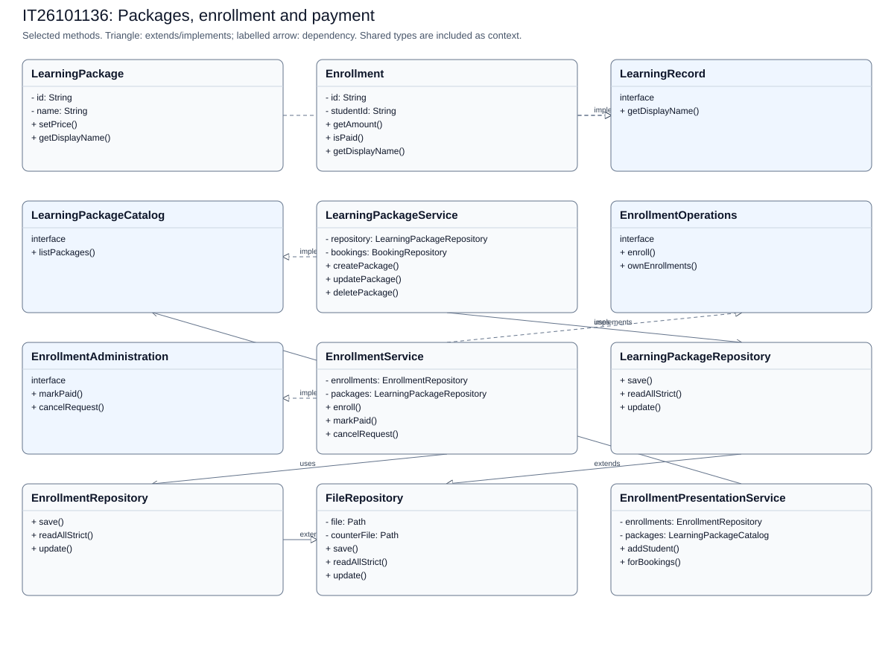
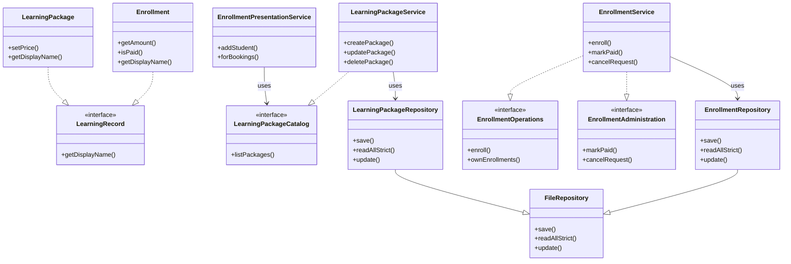

# IT26101136: Packages, enrollment and payment

[Back to the full speaking guide](README.md). [Class diagram SVG](IT26101136.svg). [Mermaid source](IT26101136.mmd).

Selected classes and methods are shown; shared dependencies are context, not ownership claims. Entities store foreign IDs rather than object compositions.

### 1. What is my module responsible for?

In our system, I use separate classes for the packages, enrollment and payment module. I keep web requests, rules and storage in separate classes.

**Show in code:** [LearningPackageController.java](../../src/main/java/com/drivingschool/learningpackage/controller/LearningPackageController.java) - `LearningPackageController`; [LearningPackageService.java](../../src/main/java/com/drivingschool/learningpackage/service/LearningPackageService.java) - `LearningPackageService`.

### 2. Where are Create and Read?

I create through LearningPackageService using createPackage and read through LearningPackageService using listPackages. I let repositories handle files after service checks.

**Show in code:** [LearningPackageService.java](../../src/main/java/com/drivingschool/learningpackage/service/LearningPackageService.java) - `createPackage`; [LearningPackageService.java](../../src/main/java/com/drivingschool/learningpackage/service/LearningPackageService.java) - `listPackages`.

### 3. Where are Update and Delete?

I update through LearningPackageService using updatePackage and delete through LearningPackageService using deletePackage. I apply deletion rules instead of breaking saved lesson or payment history.

**Show in code:** [LearningPackageService.java](../../src/main/java/com/drivingschool/learningpackage/service/LearningPackageService.java) - `updatePackage`; [LearningPackageService.java](../../src/main/java/com/drivingschool/learningpackage/service/LearningPackageService.java) - `deletePackage`.

### 4. Where did I use encapsulation?

I keep LearningPackage fields private and use checked methods to control changes. I use setPrice to reject invalid values instead of trusting a form.

**Show in code:** [LearningPackage.java](../../src/main/java/com/drivingschool/learningpackage/model/LearningPackage.java) - `setPrice`.

### 5. Where did I use abstraction?

I use LearningPackageCatalog for package-reading tasks and EnrollmentOperations for student enrollment tasks. I keep admin payment tasks in EnrollmentAdministration.

**Show in code:** [LearningPackageCatalog.java](../../src/main/java/com/drivingschool/learningpackage/service/LearningPackageCatalog.java) - `class declaration`; [EnrollmentOperations.java](../../src/main/java/com/drivingschool/learningpackage/service/EnrollmentOperations.java) - `class declaration`; [EnrollmentAdministration.java](../../src/main/java/com/drivingschool/learningpackage/service/EnrollmentAdministration.java) - `class declaration`.

### 6. Where did I use inheritance?

I make LearningPackageRepository extend FileRepository for storage rules. I do not make Enrollment extend LearningPackage because they are different records.

**Show in code:** [LearningPackageRepository.java](../../src/main/java/com/drivingschool/learningpackage/repository/LearningPackageRepository.java) - `class declaration`; [Enrollment.java](../../src/main/java/com/drivingschool/learningpackage/model/Enrollment.java) - `class declaration`.

### 7. Where did I use polymorphism?

I let LearningPackage and Enrollment implement the same LearningRecord display contract. I can call their display methods through that contract, although current pages use presentation helpers for resolved package names.

**Show in code:** [LearningRecord.java](../../src/main/java/com/drivingschool/learningpackage/model/LearningRecord.java) - `getDisplayName`; [LearningPackage.java](../../src/main/java/com/drivingschool/learningpackage/model/LearningPackage.java) - `getDisplayName`; [Enrollment.java](../../src/main/java/com/drivingschool/learningpackage/model/Enrollment.java) - `getDisplayName`.

### 8. How did I use exception handling as the fifth course topic?

I use DuplicateRecordException when this module cannot accept a requested change. I let the shared handler explain it safely instead of exposing file details.

**Show in code:** [LearningPackageService.java](../../src/main/java/com/drivingschool/learningpackage/service/LearningPackageService.java) - `ensureUniqueName`; [GlobalExceptionHandler.java](../../src/main/java/com/drivingschool/common/exception/GlobalExceptionHandler.java) - `handleDuplicate`.

### 9. How do I explain Single Responsibility and Open/Closed?

I build read-only labels in EnrollmentPresentationService while EnrollmentService handles payment rules. I can add another LearningRecord without rewriting existing records, although a page must choose to use it.

**Show in code:** [EnrollmentPresentationService.java](../../src/main/java/com/drivingschool/learningpackage/service/EnrollmentPresentationService.java) - `addStudent`; [LearningRecord.java](../../src/main/java/com/drivingschool/learningpackage/model/LearningRecord.java) - `getDisplayName`.

### 10. How do I explain Liskov, Interface Segregation and Dependency Inversion?

I preserve the shared storage contract in LearningPackageRepository. I separate student EnrollmentOperations from admin EnrollmentAdministration. I inject EnrollmentOperations into EnrollmentController.

**Show in code:** [LearningPackageRepository.java](../../src/main/java/com/drivingschool/learningpackage/repository/LearningPackageRepository.java) - `save`; [EnrollmentAdministration.java](../../src/main/java/com/drivingschool/learningpackage/service/EnrollmentAdministration.java) - `class declaration`; [EnrollmentController.java](../../src/main/java/com/drivingschool/learningpackage/controller/EnrollmentController.java) - `EnrollmentController`.

### 11. How do I explain Payment confirmation and packages?

I recheck the waiting request, student and course inside the shared account lock. I activate lessons and save the Paid receipt, with validity starting on confirmation day. I do not claim a transaction because those are separate file updates.

**Show in code:** [EnrollmentService.java](../../src/main/java/com/drivingschool/learningpackage/service/EnrollmentService.java) - `markPaid`; [EnrollmentService.java](../../src/main/java/com/drivingschool/learningpackage/service/EnrollmentService.java) - `activateLessons`; [AccountWriteCoordinator.java](../../src/main/java/com/drivingschool/auth/util/AccountWriteCoordinator.java) - `execute`.

### 12. What should I demonstrate honestly?

I can demonstrate the packages, enrollment and payment pages using disposable seeded data. I use server-side rules and tests as evidence, and mark an unconfirmed demonstration NEEDS CHECK.

**Show in code:** [LearningPackageService.java](../../src/main/java/com/drivingschool/learningpackage/service/LearningPackageService.java) - `LearningPackageService`.

**Show in browser:** Open My enrollments as student8 > Open Payment instructions > Return to My enrollments > Open Packages > Open View package.

## Files bearing this member header

- [src/main/java/com/drivingschool/learningpackage/config/LearningPackageConfig.java](../../src/main/java/com/drivingschool/learningpackage/config/LearningPackageConfig.java)
- [src/main/java/com/drivingschool/learningpackage/controller/AdminEnrollmentController.java](../../src/main/java/com/drivingschool/learningpackage/controller/AdminEnrollmentController.java)
- [src/main/java/com/drivingschool/learningpackage/controller/EnrollmentController.java](../../src/main/java/com/drivingschool/learningpackage/controller/EnrollmentController.java)
- [src/main/java/com/drivingschool/learningpackage/controller/LearningPackageController.java](../../src/main/java/com/drivingschool/learningpackage/controller/LearningPackageController.java)
- [src/main/java/com/drivingschool/learningpackage/controller/LocalPhotoAdvice.java](../../src/main/java/com/drivingschool/learningpackage/controller/LocalPhotoAdvice.java)
- [src/main/java/com/drivingschool/learningpackage/controller/PackageEnrollmentEntryController.java](../../src/main/java/com/drivingschool/learningpackage/controller/PackageEnrollmentEntryController.java)
- [src/main/java/com/drivingschool/learningpackage/controller/PackageNavigationAdvice.java](../../src/main/java/com/drivingschool/learningpackage/controller/PackageNavigationAdvice.java)
- [src/main/java/com/drivingschool/learningpackage/dto/EnrollmentUsageView.java](../../src/main/java/com/drivingschool/learningpackage/dto/EnrollmentUsageView.java)
- [src/main/java/com/drivingschool/learningpackage/model/Enrollment.java](../../src/main/java/com/drivingschool/learningpackage/model/Enrollment.java)
- [src/main/java/com/drivingschool/learningpackage/model/LearningPackage.java](../../src/main/java/com/drivingschool/learningpackage/model/LearningPackage.java)
- [src/main/java/com/drivingschool/learningpackage/model/LearningRecord.java](../../src/main/java/com/drivingschool/learningpackage/model/LearningRecord.java)
- [src/main/java/com/drivingschool/learningpackage/model/PackageNavigationCard.java](../../src/main/java/com/drivingschool/learningpackage/model/PackageNavigationCard.java)
- [src/main/java/com/drivingschool/learningpackage/model/PackageType.java](../../src/main/java/com/drivingschool/learningpackage/model/PackageType.java)
- [src/main/java/com/drivingschool/learningpackage/repository/EnrollmentRepository.java](../../src/main/java/com/drivingschool/learningpackage/repository/EnrollmentRepository.java)
- [src/main/java/com/drivingschool/learningpackage/repository/LearningPackageRepository.java](../../src/main/java/com/drivingschool/learningpackage/repository/LearningPackageRepository.java)
- [src/main/java/com/drivingschool/learningpackage/service/EnrollmentAdministration.java](../../src/main/java/com/drivingschool/learningpackage/service/EnrollmentAdministration.java)
- [src/main/java/com/drivingschool/learningpackage/service/EnrollmentOperations.java](../../src/main/java/com/drivingschool/learningpackage/service/EnrollmentOperations.java)
- [src/main/java/com/drivingschool/learningpackage/service/EnrollmentPresentationService.java](../../src/main/java/com/drivingschool/learningpackage/service/EnrollmentPresentationService.java)
- [src/main/java/com/drivingschool/learningpackage/service/EnrollmentService.java](../../src/main/java/com/drivingschool/learningpackage/service/EnrollmentService.java)
- [src/main/java/com/drivingschool/learningpackage/service/LearningPackageCatalog.java](../../src/main/java/com/drivingschool/learningpackage/service/LearningPackageCatalog.java)
- [src/main/java/com/drivingschool/learningpackage/service/LearningPackageService.java](../../src/main/java/com/drivingschool/learningpackage/service/LearningPackageService.java)
- [src/main/resources/static/css/app.css](../../src/main/resources/static/css/app.css)
- [src/main/resources/static/css/tailwind.css](../../src/main/resources/static/css/tailwind.css)
- [src/main/resources/static/js/site.js](../../src/main/resources/static/js/site.js)
- [src/main/webapp/WEB-INF/views/admin/enrollments.jsp](../../src/main/webapp/WEB-INF/views/admin/enrollments.jsp)
- [src/main/webapp/WEB-INF/views/admin/packages.jsp](../../src/main/webapp/WEB-INF/views/admin/packages.jsp)
- [src/main/webapp/WEB-INF/views/common/components/confirm-dialog.jspf](../../src/main/webapp/WEB-INF/views/common/components/confirm-dialog.jspf)
- [src/main/webapp/WEB-INF/views/common/components/empty-state.jspf](../../src/main/webapp/WEB-INF/views/common/components/empty-state.jspf)
- [src/main/webapp/WEB-INF/views/common/components/enrollment-usage.jspf](../../src/main/webapp/WEB-INF/views/common/components/enrollment-usage.jspf)
- [src/main/webapp/WEB-INF/views/common/components/local-photo.jspf](../../src/main/webapp/WEB-INF/views/common/components/local-photo.jspf)
- [src/main/webapp/WEB-INF/views/common/components/page-header.jspf](../../src/main/webapp/WEB-INF/views/common/components/page-header.jspf)
- [src/main/webapp/WEB-INF/views/common/components/status-badge.jspf](../../src/main/webapp/WEB-INF/views/common/components/status-badge.jspf)
- [src/main/webapp/WEB-INF/views/common/components/tabs.jspf](../../src/main/webapp/WEB-INF/views/common/components/tabs.jspf)
- [src/main/webapp/WEB-INF/views/common/components/toasts.jspf](../../src/main/webapp/WEB-INF/views/common/components/toasts.jspf)
- [src/main/webapp/WEB-INF/views/common/dashboard-sidebar.jspf](../../src/main/webapp/WEB-INF/views/common/dashboard-sidebar.jspf)
- [src/main/webapp/WEB-INF/views/common/error.jsp](../../src/main/webapp/WEB-INF/views/common/error.jsp)
- [src/main/webapp/WEB-INF/views/common/footer.jspf](../../src/main/webapp/WEB-INF/views/common/footer.jspf)
- [src/main/webapp/WEB-INF/views/common/navbar.jspf](../../src/main/webapp/WEB-INF/views/common/navbar.jspf)
- [src/main/webapp/WEB-INF/views/common/setup-check.jsp](../../src/main/webapp/WEB-INF/views/common/setup-check.jsp)
- [src/main/webapp/WEB-INF/views/learningpackage/detail.jsp](../../src/main/webapp/WEB-INF/views/learningpackage/detail.jsp)
- [src/main/webapp/WEB-INF/views/learningpackage/list.jsp](../../src/main/webapp/WEB-INF/views/learningpackage/list.jsp)
- [src/main/webapp/WEB-INF/views/public/about.jsp](../../src/main/webapp/WEB-INF/views/public/about.jsp)
- [src/main/webapp/WEB-INF/views/public/contact.jsp](../../src/main/webapp/WEB-INF/views/public/contact.jsp)
- [src/main/webapp/WEB-INF/views/public/faq.jsp](../../src/main/webapp/WEB-INF/views/public/faq.jsp)
- [src/main/webapp/WEB-INF/views/student/enrollments.jsp](../../src/main/webapp/WEB-INF/views/student/enrollments.jsp)
- [src/main/webapp/WEB-INF/views/student/payment-instructions.jsp](../../src/main/webapp/WEB-INF/views/student/payment-instructions.jsp)
- [src/test/java/com/drivingschool/learningpackage/AdminEnrollmentWebIntegrationTest.java](../../src/test/java/com/drivingschool/learningpackage/AdminEnrollmentWebIntegrationTest.java)
- [src/test/java/com/drivingschool/learningpackage/EnrollmentWebIntegrationTest.java](../../src/test/java/com/drivingschool/learningpackage/EnrollmentWebIntegrationTest.java)
- [src/test/java/com/drivingschool/learningpackage/config/LearningPackageConfigTest.java](../../src/test/java/com/drivingschool/learningpackage/config/LearningPackageConfigTest.java)
- [src/test/java/com/drivingschool/learningpackage/model/LearningPackageTest.java](../../src/test/java/com/drivingschool/learningpackage/model/LearningPackageTest.java)
- [src/test/java/com/drivingschool/learningpackage/repository/LearningPackageRepositoryTest.java](../../src/test/java/com/drivingschool/learningpackage/repository/LearningPackageRepositoryTest.java)
- [src/test/java/com/drivingschool/learningpackage/service/EnrollmentPaymentServiceTest.java](../../src/test/java/com/drivingschool/learningpackage/service/EnrollmentPaymentServiceTest.java)
- [src/test/java/com/drivingschool/learningpackage/service/EnrollmentPresentationServiceTest.java](../../src/test/java/com/drivingschool/learningpackage/service/EnrollmentPresentationServiceTest.java)
- [src/test/java/com/drivingschool/learningpackage/service/EnrollmentServiceTest.java](../../src/test/java/com/drivingschool/learningpackage/service/EnrollmentServiceTest.java)
- [src/test/java/com/drivingschool/learningpackage/service/LearningPackageLifecycleTest.java](../../src/test/java/com/drivingschool/learningpackage/service/LearningPackageLifecycleTest.java)
- [src/test/java/com/drivingschool/learningpackage/service/LearningPackageServiceTest.java](../../src/test/java/com/drivingschool/learningpackage/service/LearningPackageServiceTest.java)
- [src/test/java/com/drivingschool/learningpackage/service/PackageNavigationAdviceTest.java](../../src/test/java/com/drivingschool/learningpackage/service/PackageNavigationAdviceTest.java)

## Custom exceptions to point to

| Exception | Actual source | Meaning |
| --- | --- | --- |
| ValidationException | [LearningPackage.java](../../src/main/java/com/drivingschool/learningpackage/model/LearningPackage.java) - `setPrice` | Invalid input |
| DuplicateRecordException | [FileRepository.java](../../src/main/java/com/drivingschool/common/repository/FileRepository.java) - `save` | An ID already exists; module helpers also check business duplicates |
| RecordNotFoundException | [FileRepository.java](../../src/main/java/com/drivingschool/common/repository/FileRepository.java) - `update` | The requested stored record is missing |
| StorageException | [FileRepository.java](../../src/main/java/com/drivingschool/common/repository/FileRepository.java) - `readAllStrict` | Damaged or unreadable storage |

## Enrollment CRUD alongside package CRUD

| Operation | Actual method |
| --- | --- |
| Create unpaid request | EnrollmentService.enroll |
| Read owned requests | EnrollmentService.ownEnrollments / ownEnrollment |
| Update goal or confirm payment | EnrollmentService.updateLearningGoal / markPaid |
| Delete unused unpaid request | EnrollmentService.deleteOwnEnrollment |

Paid receipts and linked history are protected. Show in code: [EnrollmentService.java](../../src/main/java/com/drivingschool/learningpackage/service/EnrollmentService.java), the methods above.
