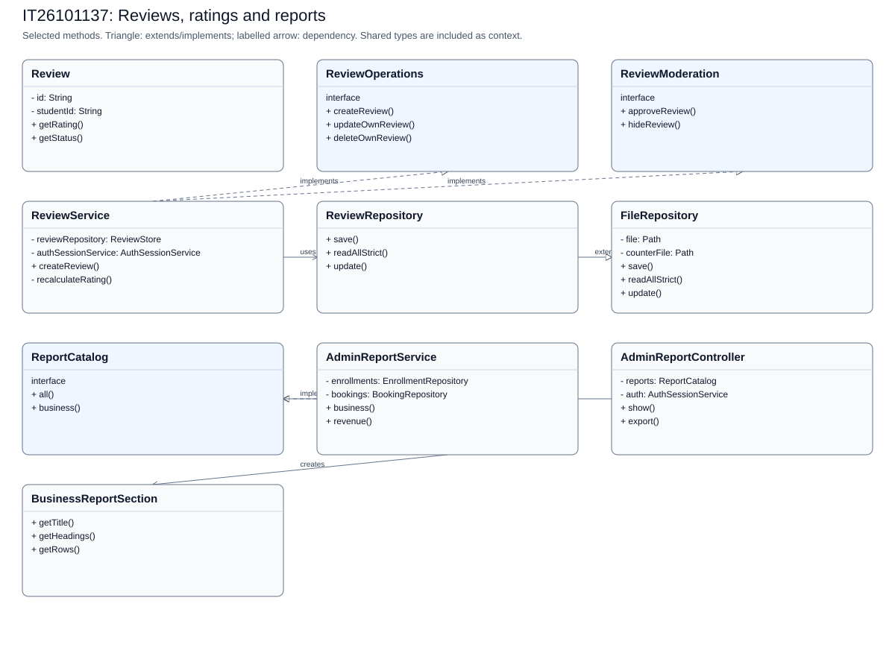
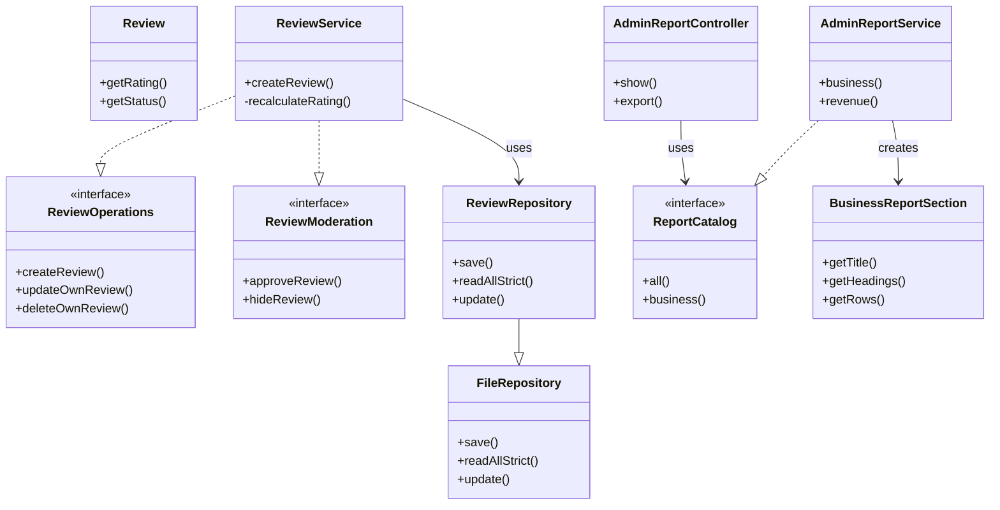

# IT26101137: Reviews, ratings and reports

[Back to the full speaking guide](README.md). [Class diagram SVG](IT26101137.svg). [Mermaid source](IT26101137.mmd).

Selected classes and methods are shown; shared dependencies are context, not ownership claims. Entities store foreign IDs rather than object compositions.

### 1. What is my module responsible for?

In our system, I use separate classes for the reviews, ratings and reports module. I keep web requests, rules and storage in separate classes.

**Show in code:** [ReviewController.java](../../src/main/java/com/drivingschool/review/controller/ReviewController.java) - `ReviewController`; [ReviewService.java](../../src/main/java/com/drivingschool/review/service/ReviewService.java) - `ReviewService`.

### 2. Where are Create and Read?

I create through ReviewService using createReview and read through ReviewService using getVisibleReviews. I let repositories handle files after service checks.

**Show in code:** [ReviewService.java](../../src/main/java/com/drivingschool/review/service/ReviewService.java) - `createReview`; [ReviewService.java](../../src/main/java/com/drivingschool/review/service/ReviewService.java) - `getVisibleReviews`.

### 3. Where are Update and Delete?

I update through ReviewService using updateOwnReview and delete through ReviewService using deleteOwnReview. I apply deletion rules instead of breaking saved lesson or payment history.

**Show in code:** [ReviewService.java](../../src/main/java/com/drivingschool/review/service/ReviewService.java) - `updateOwnReview`; [ReviewService.java](../../src/main/java/com/drivingschool/review/service/ReviewService.java) - `deleteOwnReview`.

### 4. Where did I use encapsulation?

I keep Review fields private and use checked methods to control changes. I use Review to reject invalid values instead of trusting a form.

**Show in code:** [Review.java](../../src/main/java/com/drivingschool/review/model/Review.java) - `Review`.

### 5. Where did I use abstraction?

I expose student feedback through ReviewOperations and moderation through ReviewModeration. I expose report tables through ReportCatalog so the controller does not calculate them.

**Show in code:** [ReviewOperations.java](../../src/main/java/com/drivingschool/review/service/ReviewOperations.java) - `class declaration`; [ReviewModeration.java](../../src/main/java/com/drivingschool/review/service/ReviewModeration.java) - `class declaration`; [ReportCatalog.java](../../src/main/java/com/drivingschool/report/service/ReportCatalog.java) - `business`.

### 6. Where did I use inheritance?

I make ReviewRepository extend FileRepository for shared file operations. I keep Review as a model implementing Identifiable rather than a child of a service.

**Show in code:** [ReviewRepository.java](../../src/main/java/com/drivingschool/review/repository/ReviewRepository.java) - `class declaration`; [Review.java](../../src/main/java/com/drivingschool/review/model/Review.java) - `class declaration`.

### 7. Where did I use polymorphism?

I call business through the ReportCatalog reference in the report controller. I receive the real AdminReportService object supplied by Spring.

**Show in code:** [AdminReportController.java](../../src/main/java/com/drivingschool/report/controller/AdminReportController.java) - `show`; [AdminReportService.java](../../src/main/java/com/drivingschool/report/service/AdminReportService.java) - `business`.

### 8. How did I use exception handling as the fifth course topic?

I use DuplicateRecordException when this module cannot accept a requested change. I let the shared handler explain it safely instead of exposing file details.

**Show in code:** [ReviewService.java](../../src/main/java/com/drivingschool/review/service/ReviewService.java) - `ensureNoDuplicate`; [GlobalExceptionHandler.java](../../src/main/java/com/drivingschool/common/exception/GlobalExceptionHandler.java) - `handleDuplicate`.

### 9. How do I explain Single Responsibility and Open/Closed?

I calculate tables in AdminReportService and write downloads in AdminReportController. I can supply another ReportCatalog implementation without putting calculation rules in the controller.

**Show in code:** [AdminReportService.java](../../src/main/java/com/drivingschool/report/service/AdminReportService.java) - `business`; [AdminReportController.java](../../src/main/java/com/drivingschool/report/controller/AdminReportController.java) - `export`; [ReportCatalog.java](../../src/main/java/com/drivingschool/report/service/ReportCatalog.java) - `business`.

### 10. How do I explain Liskov, Interface Segregation and Dependency Inversion?

I preserve the FileRepository contract in ReviewRepository. I split ordinary review operations from ReviewModeration. I inject ReviewOperations and ReportCatalog into their controllers.

**Show in code:** [ReviewRepository.java](../../src/main/java/com/drivingschool/review/repository/ReviewRepository.java) - `save`; [ReviewModeration.java](../../src/main/java/com/drivingschool/review/service/ReviewModeration.java) - `class declaration`; [ReviewController.java](../../src/main/java/com/drivingschool/review/controller/ReviewController.java) - `ReviewController`; [AdminReportController.java](../../src/main/java/com/drivingschool/report/controller/AdminReportController.java) - `AdminReportController`.

### 11. How do I explain Paid-only revenue and business CSV?

I add captured enrollment amounts only when isPaid is true and format them with two decimals. I write a UTF-8 BOM, a business header, named sections and totals. I quote cells, neutralize formula prefixes, and offer full and section downloads.

**Show in code:** [AdminReportService.java](../../src/main/java/com/drivingschool/report/service/AdminReportService.java) - `business`; [AdminReportController.java](../../src/main/java/com/drivingschool/report/controller/AdminReportController.java) - `export`; [AdminReportController.java](../../src/main/java/com/drivingschool/report/controller/AdminReportController.java) - `csv`.

### 12. What should I demonstrate honestly?

I can demonstrate the reviews, ratings and reports pages using disposable seeded data. I use server-side rules and tests as evidence, and mark an unconfirmed demonstration NEEDS CHECK.

**Show in code:** [ReviewService.java](../../src/main/java/com/drivingschool/review/service/ReviewService.java) - `ReviewService`.

**Show in browser:** Open Reports as admin > Download a section CSV > Open Print report > Cancel printing after inspecting it > Download full CSV.

## Files bearing this member header

- [src/main/java/com/drivingschool/report/controller/AdminReportController.java](../../src/main/java/com/drivingschool/report/controller/AdminReportController.java)
- [src/main/java/com/drivingschool/report/service/AdminReportService.java](../../src/main/java/com/drivingschool/report/service/AdminReportService.java)
- [src/main/java/com/drivingschool/report/service/BusinessReportSection.java](../../src/main/java/com/drivingschool/report/service/BusinessReportSection.java)
- [src/main/java/com/drivingschool/report/service/ReportCatalog.java](../../src/main/java/com/drivingschool/report/service/ReportCatalog.java)
- [src/main/java/com/drivingschool/report/service/ReportRow.java](../../src/main/java/com/drivingschool/report/service/ReportRow.java)
- [src/main/java/com/drivingschool/report/service/ReportSection.java](../../src/main/java/com/drivingschool/report/service/ReportSection.java)
- [src/main/java/com/drivingschool/review/api/ReviewStore.java](../../src/main/java/com/drivingschool/review/api/ReviewStore.java)
- [src/main/java/com/drivingschool/review/controller/AdminReviewController.java](../../src/main/java/com/drivingschool/review/controller/AdminReviewController.java)
- [src/main/java/com/drivingschool/review/controller/PublicReviewController.java](../../src/main/java/com/drivingschool/review/controller/PublicReviewController.java)
- [src/main/java/com/drivingschool/review/controller/ReviewController.java](../../src/main/java/com/drivingschool/review/controller/ReviewController.java)
- [src/main/java/com/drivingschool/review/model/Review.java](../../src/main/java/com/drivingschool/review/model/Review.java)
- [src/main/java/com/drivingschool/review/model/ReviewStatus.java](../../src/main/java/com/drivingschool/review/model/ReviewStatus.java)
- [src/main/java/com/drivingschool/review/repository/ReviewRepository.java](../../src/main/java/com/drivingschool/review/repository/ReviewRepository.java)
- [src/main/java/com/drivingschool/review/service/ReviewModeration.java](../../src/main/java/com/drivingschool/review/service/ReviewModeration.java)
- [src/main/java/com/drivingschool/review/service/ReviewOperations.java](../../src/main/java/com/drivingschool/review/service/ReviewOperations.java)
- [src/main/java/com/drivingschool/review/service/ReviewService.java](../../src/main/java/com/drivingschool/review/service/ReviewService.java)
- [src/main/resources/static/css/report.css](../../src/main/resources/static/css/report.css)
- [src/main/webapp/WEB-INF/views/admin/reports.jsp](../../src/main/webapp/WEB-INF/views/admin/reports.jsp)
- [src/main/webapp/WEB-INF/views/admin/reviews.jsp](../../src/main/webapp/WEB-INF/views/admin/reviews.jsp)
- [src/main/webapp/WEB-INF/views/common/components/review-tabs.jspf](../../src/main/webapp/WEB-INF/views/common/components/review-tabs.jspf)
- [src/main/webapp/WEB-INF/views/common/components/star-display.jspf](../../src/main/webapp/WEB-INF/views/common/components/star-display.jspf)
- [src/main/webapp/WEB-INF/views/common/components/star-input.jspf](../../src/main/webapp/WEB-INF/views/common/components/star-input.jspf)
- [src/main/webapp/WEB-INF/views/public/reviews.jsp](../../src/main/webapp/WEB-INF/views/public/reviews.jsp)
- [src/main/webapp/WEB-INF/views/review/list.jsp](../../src/main/webapp/WEB-INF/views/review/list.jsp)
- [src/test/java/com/drivingschool/review/ReviewWebIntegrationTest.java](../../src/test/java/com/drivingschool/review/ReviewWebIntegrationTest.java)
- [src/test/java/com/drivingschool/review/model/ReviewTest.java](../../src/test/java/com/drivingschool/review/model/ReviewTest.java)
- [src/test/java/com/drivingschool/review/repository/ReviewRepositoryTest.java](../../src/test/java/com/drivingschool/review/repository/ReviewRepositoryTest.java)
- [src/test/java/com/drivingschool/review/service/AdminReportServiceTest.java](../../src/test/java/com/drivingschool/review/service/AdminReportServiceTest.java)
- [src/test/java/com/drivingschool/review/service/InstructorRatingRecalculationTest.java](../../src/test/java/com/drivingschool/review/service/InstructorRatingRecalculationTest.java)
- [src/test/java/com/drivingschool/review/service/ReviewServiceConcurrencyTest.java](../../src/test/java/com/drivingschool/review/service/ReviewServiceConcurrencyTest.java)
- [src/test/java/com/drivingschool/review/service/ReviewServiceTest.java](../../src/test/java/com/drivingschool/review/service/ReviewServiceTest.java)
- [src/test/java/com/drivingschool/review/service/ReviewVisibilityTest.java](../../src/test/java/com/drivingschool/review/service/ReviewVisibilityTest.java)

## Custom exceptions to point to

| Exception | Actual source | Meaning |
| --- | --- | --- |
| ValidationException | [Review.java](../../src/main/java/com/drivingschool/review/model/Review.java) - `Review` | Invalid input |
| DuplicateRecordException | [FileRepository.java](../../src/main/java/com/drivingschool/common/repository/FileRepository.java) - `save` | An ID already exists; module helpers also check business duplicates |
| RecordNotFoundException | [FileRepository.java](../../src/main/java/com/drivingschool/common/repository/FileRepository.java) - `update` | The requested stored record is missing |
| StorageException | [FileRepository.java](../../src/main/java/com/drivingschool/common/repository/FileRepository.java) - `readAllStrict` | Damaged or unreadable storage |
